# EULNO – Deterministische Datenkompression

Funktionsreferenz & Benutzerhandbuch (Functional Reference & User Guide)

Verständliche Einführung mit Bildbeispielen, mathematischer Kurzfassung und praktischer CLI-Anleitung

Software-Stand: EULNO Beta Engine & CLI Suite v0.9.5-beta (.elp8 / .elp3d)

Standardisierung: Konform zu IETF Internet-Draft draft-heilos-eulno-elp8-00

Autor & Projektleitung: Robin Heilos (McCalm)

Projekt-Portale: https://eulno.org | Hugging Face | GitHub

Lizenz & Widmung: EULNO Studio Community License v2.0 (Gewidmet Leonhard Euler & Emmy Noether)

Dokumentenstatus: Deutsche Referenzfassung (Stand: November 2026 – Basis für englische Übersetzung)

---

## KAPITEL 1: DAS FUNDAMENT – VERLUSTFREIHEIT & DIE 256-STUNDEN-UHR

### 1.1 Das Bild im Kopf: Warum Computer auf einer Uhr rechnen müssen

Stell dir vor, du öffnest eine digitale Datei auf deinem Computer – ein gestochen scharfes Urlaubsfoto, deinen Lieblingssong, ein wichtiges Vertragsdokument oder ein modernes KI-Modell. Für unsere Augen und Ohren sind das Farben, Melodien und Sätze. Doch für den Prozessor im Inneren deines Rechners existiert all das nicht. Für ihn besteht jede Datei der Welt aus einer einzigen, scheinbar endlos langen Perlenkette winziger Bausteine: den sogenannten Bytes.

Was aber steckt hinter einem einzigen Byte? Stell dir eine kleine Schalttafel mit genau acht Lichtschaltern nebeneinander vor – das sind 8 Bits. Jeder einzelne Schalter kennt nur zwei Zustände: AUS (0) oder AN (1). Wenn du systematisch alle möglichen Schalterstellungen durchprobierst, kommst du auf exakt 256 verschiedene Kombinationen (von „alle acht Schalter AUS“ bis „alle acht Schalter AN“). Deshalb ist jedes Byte in einer Datei nichts anderes als eine saubere, ganz normale Zahl zwischen 0 und 255. Nicht mehr und nicht weniger.

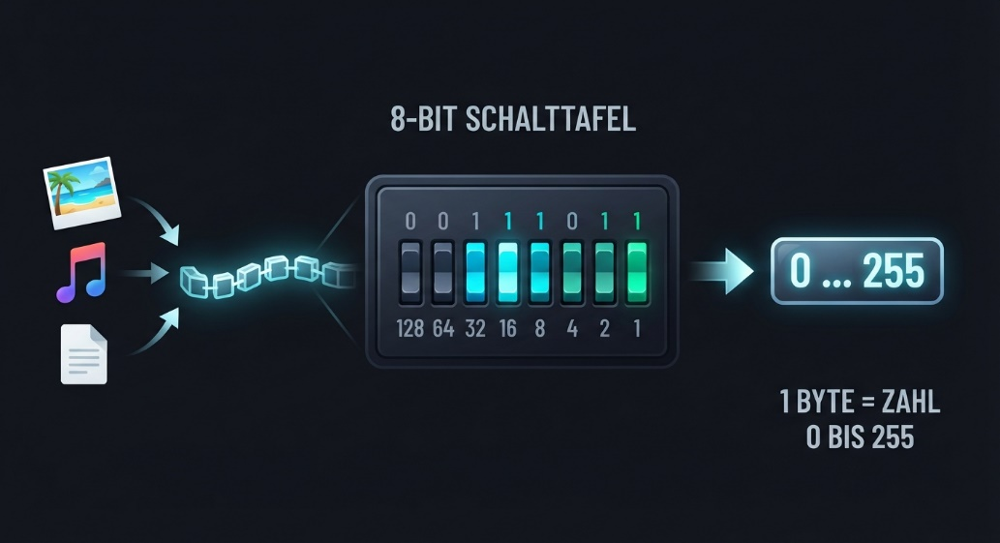

*Abbildung 1A: Von der Datei zur Zahl – Jedes Byte entspricht einer 8-Bit-Schalttafel mit genau 256 möglichen Schalterstellungen (0 bis 255).*

Hier lauert nun eine tückische Falle vieler herkömmlicher Rechenmethoden: Sie verlassen die sichere Welt der ganzen Zahlen und rechnen stattdessen mit Kommazahlen – zum Beispiel mit der berühmten Kreiszahl π (Pi ≈ 3,14159265…) oder mit periodischen Brüchen wie 1/3 (= 0,333333…). Solche Zahlen besitzen unendlich viele Nachkommastellen und hören niemals auf. Da der Speicher eines Computers aber begrenzt ist, muss er solche unendlichen Zahlen irgendwann brutal abschneiden und runden. Das ist wie beim ständigen Umrechnen von Währungen, bei dem durch Auf- und Abrunden plötzlich ein Cent im Nichts verschwindet. Was bei einem Foto vielleicht nur als winziger Farbschatten auffällt, wäre bei einer komprimierten Datei oder einem Programmcode der sofortige Totalschaden: Ein einziges durch Rundung gekipptes Bit reicht aus, und eine Software stürzt ab oder dein gesamtes Archiv lässt sich nie wieder öffnen.

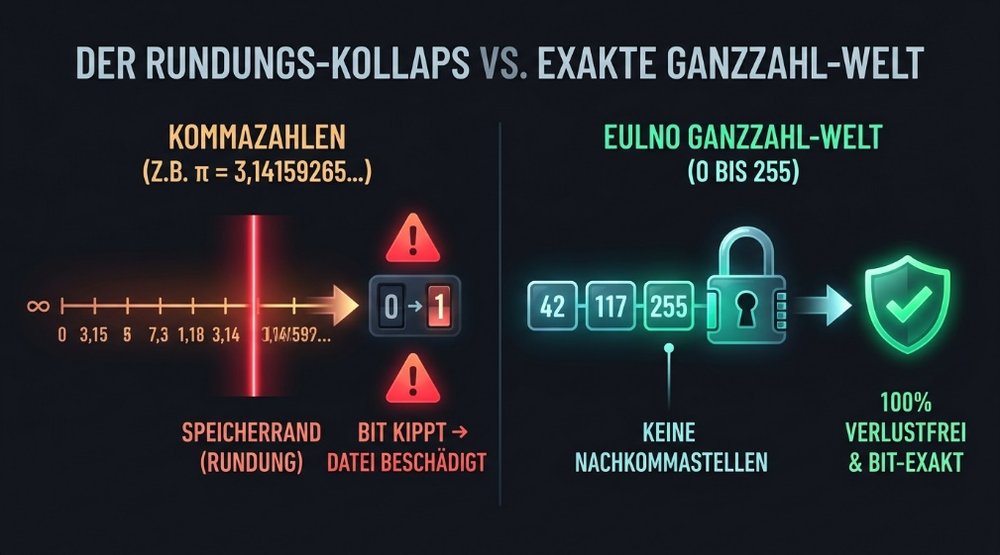

*Abbildung 1B: Der Rundungs-Kollaps vs. Exakte Ganzzahl-Welt – Während Kommazahlen (wie π) am Speicherrand abgeschnitten werden und Bits kippen lassen, arbeitet EULNO ausschließlich mit exakten ganzen Zahlen von 0 bis 255.*

Genau hier setzt EULNO mit zwei eisernen Grundgesetzen an

1. Keine Kommazahlen, niemals!

Im gesamten Rechenwerk von EULNO gibt es keine einzige Kommazahl. Alles – wirklich jeder einzelne Rechenschritt beim Packen und Entpacken – wird ausschließlich mit exakten ganzen Zahlen durchgeführt. Wo nicht gerundet wird, kann auch kein Fehler entstehen.

2. Rechnen auf dem Zifferblatt (Die 256-Stunden-Uhr)

Wenn man ganze Zahlen zusammenzählt oder voneinander abzieht, taucht schnell ein neues Problem auf: Was passiert, wenn man bei 254 steht und 3 dazuzählt? Das Ergebnis wäre 257 – aber die Zahl 257 passt nicht mehr in ein Byte (das ja bei 255 endet)! Und was passiert, wenn man von der Zahl 1 die Zahl 254 abzieht? Dann landet man bei −253 – einer riesigen negativen Zahl.

EULNO löst das mit einem genialen Trick aus der Zahlentheorie: Statt auf einem unendlichen Zahlenstrahl zu rechnen, legt EULNO alle Zahlen auf das Zifferblatt einer runden Uhr mit 256 Stunden (von 0 bis 255).

- **Der Hinweg (Packen):** Stell dir vor, ein Pixel in einem Bild hat den Helligkeitswert 254 und der Pixel direkt daneben hat den Wert 1. Statt den riesigen Sprung von 254 nach 1 als „−253“ zu speichern, schaut EULNO auf die Uhr: Von 254 über die 255 und die 0 bis zur 1 sind es nur 3 winzige Schritte vorwärts (+3)! EULNO merkt sich also nur die kleine Zahl +3.
- **Der Rückweg (Entpacken):** Wenn der Entpacker später die Datei wiederherstellt, liest er den ersten Pixel (254) und den gespeicherten Schritt (+3). Auf der 256-Stunden-Uhr geht er von 254 einfach 3 Schritte weiter: 255 → 0 → 1. Und schon steht exakt wieder die 1 da!

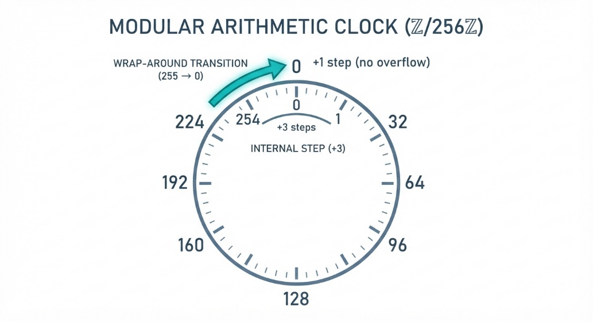

*Abbildung 1C: Die 256-Stunden-Uhr (ℤ/256ℤ) in Aktion – Der Zeiger wandert bei 254 um genau 3 Schritte über die 255 und die 0 hinweg bis zur 1 (Hinweg +3) und findet beim Entpacken wieder bitgenau zurück. Sprünge über die Grenze zwischen 255 und 0 bleiben ohne Überlauf und Rundungsfehler vollständig umkehrbar.*

Weil jeder Weg auf dieser Uhr absolut eindeutig hin und wieder zurückgegangen werden kann, verhält sich EULNO wie ein perfektes Puzzle: Jedes Teil der Originaldatei wird eindeutig auf ein Teil im Archiv abgebildet – und beim Entpacken wieder millimetergenau an seinen ursprünglichen Platz zurückgelegt.

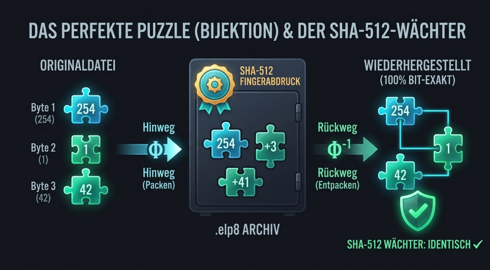

*Abbildung 1D: Das perfekte Puzzle (Bijektion) & der SHA-512-Wächter – Jedes Byte findet über die Umkehrfunktion (Φ⁻¹) exakt seinen Ursprungsplatz, während der SHA-512-Fingerabdruck im Archiv-Kopf die 100-prozentige Bit-Identität überwacht.*

Damit du dich darauf blind verlassen kannst, erstellt EULNO vor dem Packen zusätzlich einen unbestechlichen digitalen Fingerabdruck (SHA-512) deiner Originaldatei und legt ihn mit in den Tresor-Kopf des Archivs. Beim Entpacken prüft das Programm automatisch, ob die wiederhergestellte Datei exakt denselben Fingerabdruck besitzt. Stimmt auch nur ein einziges Bit nicht, schlägt EULNO sofort Alarm.

### 1.2 Kurzfassung für die Fachwelt (Mathematische Notation & Strukturprinzipien)

Für Mathematiker, Physiker und Informatiker liegt die Eleganz von EULNO darin, dass Datenkompression nicht als heuristische Näherung, sondern als streng deterministisches, algebraisch geschlossenes System über diskreten Strukturen formuliert ist:

- **Bijektivität und strenge Informationserhaltung (Verlustfreiheit)**
Sei Σ := {0, 1, …, 255} ≅ ℤ/256ℤ das Byte-Alphabet und Σ* die Menge aller endlichen Byte-Ströme (einschließlich der leeren Datei mit Länge |X| = 0). Der Codec definiert eine strikt bijektive Abbildung zwischen Σ* und der Bildmenge aller wohlgeformten ELP8-Container-Archive A_ELP8 := Φ(Σ*) ⊂ Σ*:

Φ : Σ* ↔ A_ELP8

Für jede zulässige Eingabedatei X ∈ Σ* existiert eine eindeutige, deterministische Umkehrabbildung Φ⁻¹ ohne Verlust des Gesamtinformationsgehalts (analog zu einem diskreten Erhaltungssatz):

Φ⁻¹(Φ(X)) = X   ∀ X ∈ Σ*

- **Arithmetische Reinheit und striktes IEEE-754-Verbot**
Sämtliche Transformationen und Prädiktoren operieren ausschließlich auf den ganzen Zahlen (ℤ) sowie im endlichen, kommutativen Restklassenring modulo 256, dessen kanonisches Repräsentantensystem das Byte-Alphabet Σ bildet. Fließkomma-Operationen nach IEEE-754 sind im gesamten Encoder- und Decoder-Pfad ausnahmslos ausgeschlossen. Damit eliminiert EULNO jede Form von Rundungsrauschen, Auslöschung oder plattformabhängiger Nicht-Assoziativität. Jede Vorwärts-Differenz Δᵢ zweier Bytes xᵢ₋₁, xᵢ ∈ Σ lässt sich auf jeder CPU-Architektur bitidentisch invertieren:

Hinrechnung (Residuum):   Δᵢ ≡ (xᵢ − xᵢ₋₁)  (mod 256)

Rückrechnung (Inversion): xᵢ ≡ (xᵢ₋₁ + Δᵢ)  (mod 256)

- **Geodätische Ring-Differenz & Paritäts-ZigZag-Bijektion**
Auf dem diskreten Kreis ℤ/256ℤ besitzen zwei Bytes x₀, x₁ ∈ Σ stets zwei Verbindungswege. EULNO wählt die kürzeste vorzeichenbehaftete Ring-Distanz (Geodäte) im symmetrischen Intervall um den Ruhepol 0, wodurch künstliche Randsprünge am Überlaufpunkt (255 ↔ 0) vollständig vermieden werden:

d_signed ≡ x₁ − x₀  (mod 256)   mit   d_signed ∈ [−128, +127]

Anschließend überführt die paritätsbasierte Bijektion ζ_ring : [−128, +127] ↔ Σ diese vorzeichenbehafteten Distanzen wieder verlustfrei in vorzeichenlose Byte-Werte:

ζ_ring(0)  = 0

ζ_ring(+k) = 2k       (gerade Zahlen für positive Schritte k ∈ {1, …, 127})

ζ_ring(−k) = 2k − 1   (ungerade Zahlen für negative Schritte k ∈ {1, …, 128})

Durch diese Abbildung bleiben kleine lokale Änderungen ohne Überlauf dicht um den Nullpunkt konzentriert und erzeugen eine maximal komprimierbare Wahrscheinlichkeitsverteilung für die nachgelagerte Entropiekodierung.

- **Kryptografische Integritätsinvariante (SHA-256 / SHA-512)**
Um die mathematische Bijektivität auch gegen physische Speicherfehler oder Manipulationen abzusichern, berechnet der Encoder vor der Transformation den kryptografischen Hashwert H₀ der Quelldatei X und verankert ihn im Container-Header:

H₀ = Hash(X) ∈ {0, 1}²⁵⁶ ∪ {0, 1}⁵¹²

Beim Dekodieren berechnet der Decoder in linearer Zeit 𝒪(|X|) den Hashwert H₁ = Hash(Φ⁻¹(C)) über den rekonstruierten Datenstrom und prüft anschließend durch einen zeitkonstanten (𝒪(1)) Bit-Vergleich die Integritätsinvariante:

H₁ = H₀

Weicht auch nur ein einziges Bit vom Originalzustand ab, wird der Ausgabestrom sofort verworfen.

---

## KAPITEL 2: DAS 7-GANG-GETRIEBE (DER MDL-AUTO-ROUTER G0 BIS G6)

### 2.1 Das Bild im Kopf: Ein intelligentes Automatikgetriebe & die 32-KiB-Testfahrt

In der digitalen Welt existieren Tausende verschiedene Dateiformate. Doch wenn man sie durch die Brille der Mathematik betrachtet, lassen sich nahezu alle Daten auf vier grundlegende Struktur-Typen zurückführen – hier gezeigt an vier typischen Beispielen aus dem Alltag:

- **Wiederkehrende Zeichen- und Wortmuster:** Ein Textdokument, eine Konfigurationsdatei oder Programmcode besteht aus immer wieder auftauchenden Buchstaben, Befehlen und Wörtern.
- **Kontinuierliche Signale und sanfte Verläufe:** Eine unkomprimierte Musikdatei (WAV), ein Rohbild (BMP/RAW) oder eine Messreihe besteht aus weichen, auf- und abschwingenden Wellen ohne harte Sprünge.
- **Geordnete Tabellen und Zahlenmatrizen:** Ein KI-Modell oder eine Datenbank besteht aus Millionen fein abgestufter Zahlenwerte, die in festen Spalten und Ebenen organisiert sind.
- **Scheinbares Zufallsrauschen (maximale Entropie):** Ein bereits gepacktes ZIP-Archiv, ein MP4-Video oder eine verschlüsselte Datei besteht dagegen aus völlig durchmischten Bytes, in denen keine Muster mehr stecken.

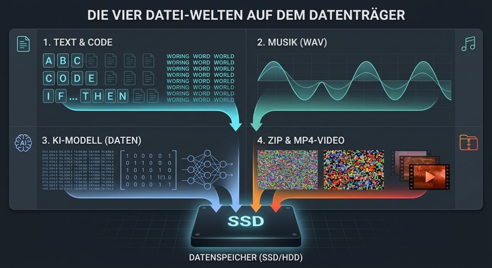

*Abbildung 2.1: Vier grundlegende Struktur-Typen digitaler Daten (Praxis-Beispiele auf dem Datenträger) – Warum EULNO ein 7-Gang-Getriebe braucht: Wiederkehrende Zeichenmuster (z. B. Text & Code), weiche Signalverläufe (z. B. WAV-Musik & Rohbilder), geordnete Zahlenmatrizen (z. B. KI-Modelle & Datenbanken) und hoch-entropisches Rauschen (z. B. ZIP, MP4 & verschlüsselte Dateien).*

Ein einzelnes Werkzeug kann unmöglich für alle diese verschiedenen Welten gleichzeitig optimal sein. Ein Hammer ist perfekt für einen Nagel, aber völlig ungeeignet für eine Schraube.

Deshalb arbeitet EULNO wie ein hochmodernes 7-Gang-Automatikgetriebe (Gänge G0 bis G6). Bevor eine Datei gepackt wird, zerteilt EULNO sie in handliche 1-MiB-Blöcke (jeweils 1.048.576 Bytes). Für jeden einzelnen Block probiert das Getriebe die passenden Gänge aus und entscheidet sich am Ende knallhart nach einem einzigen Kriterium – dem sogenannten MDL-Prinzip (Minimum Description Length): Es gewinnt immer genau der Gang, der am Ende die wenigsten Bytes auf die Festplatte schreibt.

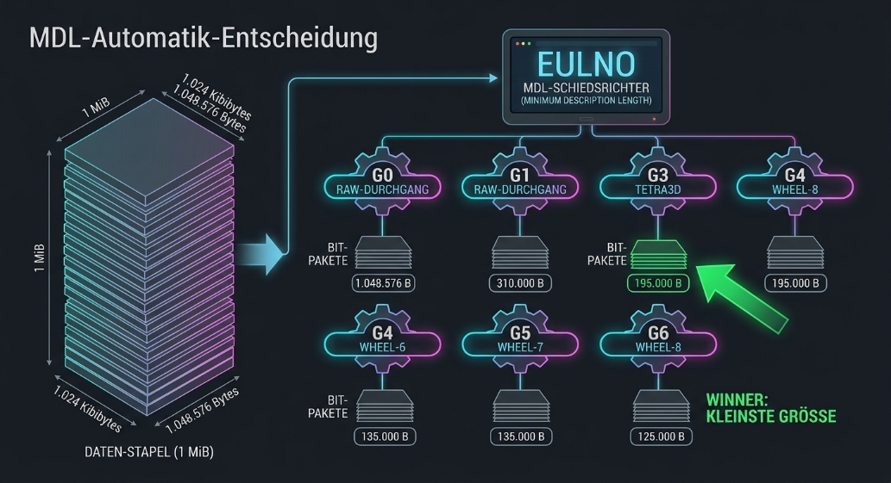

*Abbildung 2.2: Von der Datei zum 1-MiB-Block & dem 7-Gang-Wettbewerb – EULNO zerteilt jede Datei in handliche 1-MiB-Pakete (1.048.576 Bytes), schickt die Gänge G0 bis G6 ins Rennen und wählt nach dem MDL-Prinzip immer den kleinsten Ausgang für den Datenträger.*

Damit dieser Wettbewerb auch bei riesigen Dateien (wie einem 70-MB-Musikstück oder einem 2-GB-KI-Modell) blitzschnell abläuft, nutzt EULNO zwei schlaue Abkürzungen:

1. Der Rausch-Detektor (Der sofortige Leerlauf):

Bevor überhaupt ein einziger Gang eingelegt wird, prüft ein mathematischer Schnelltest auf den ersten 16 KiB eines Blocks, ob hier überhaupt noch ein Muster existiert. Dazu misst EULNO nicht nur, wie bunt die Bytes gemischt sind, sondern zieht auch jedes Byte von seinem direkten Vorgänger ab. Erst wenn sowohl die Bytes selbst als auch ihre Abstände zueinander völlig chaotisch sind (wie beim Würfeln), erkennt EULNO echtes Zufallsrauschen. In diesem Fall schaltet das Getriebe sofort in den Leerlauf (Gang G0) und kopiert den Block ohne Zeitverlust 1:1 durch. So ist mathematisch garantiert, dass eine bereits komprimierte Datei niemals künstlich aufgebläht wird.

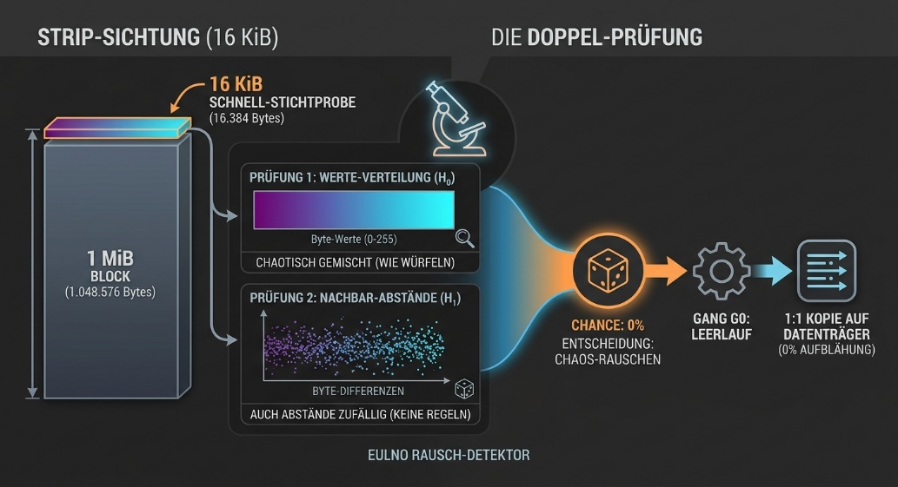

*Abbildung 2.3: Der 16-KiB-Rausch-Detektor (Schnell-Stichprobe) – EULNO prüft die ersten 16.384 Bytes (1/64 eines 1-MiB-Blocks) doppelt auf Werte-Verteilung (H₀) und Nachbar-Abstände (H₁): Zeigen beide reines Zufallsrauschen wie beim Würfeln, schaltet das Getriebe sofort in den Leerlauf (Gang G0) und kopiert den Block 1:1 ohne Aufblähung.*

2. Die 32-KiB-Testfahrt (Split-Probe)

Die beiden besonders schnellen Basis-Gänge (Gang G1 und Gang G6) laufen direkt über den gesamten 1-MiB-Block. Die vier aufwendigeren Spezial-Gänge (Gänge G2 bis G5) machen dagegen zuerst eine kurze „Probefahrt“ auf einer 32-KiB-Teststrecke. Dabei nimmt EULNO nicht einfach nur den Anfang des Blocks – denn viele Musikstücke beginnen mit ein paar Sekunden digitaler Stille, was die Testfahrt verfälschen würde! Stattdessen klebt EULNO 16 KiB vom Blockanfang und 16 KiB genau aus der Blockmitte zusammen. Nur der eine Spezial-Gang, der auf dieser Teststrecke beide Basis-Gänge schlägt, darf anschließend den gesamten 1-MiB-Block verarbeiten.

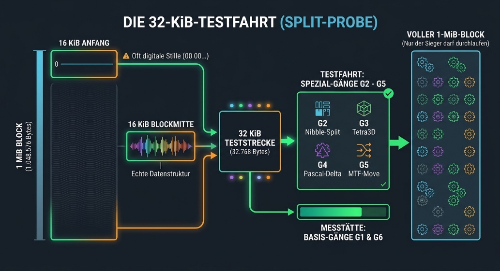

*Abbildung 2.4: Die 32-KiB-Testfahrt (Split-Probe) – EULNO kombiniert 16 KiB vom Blockanfang und 16 KiB aus der Blockmitte zu einer 32.768 Bytes großen Teststrecke, damit digitale Stille am Dateianfang das Ergebnis nicht verfälscht. Nur der Spezial-Gang (G2 bis G5), der hier beide Basis-Gänge (G1 und G6) schlägt, darf den vollen 1-MiB-Block verarbeiten.*

### 2.2 Die 7 Gänge im Detail: Was passiert im Inneren – und wie geht es wieder zurück?

- **Gang G0 – Der Direktgang (Raw-Bypass)**
Der Sicherheits-Anker von EULNO. Wenn kein anderer Gang den Block verkleinern kann, wird der Block unverändert übernommen.

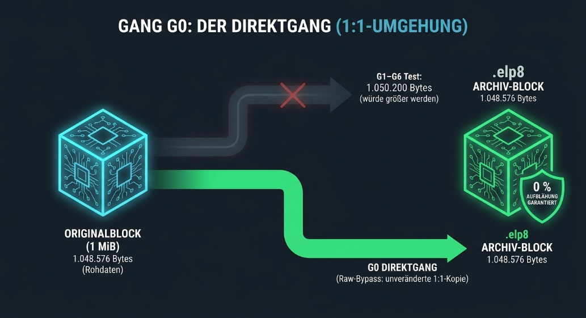

*Abbildung 2.6: Gang G0 – Der Direktgang (Raw-Bypass) – Wenn ein 1-MiB-Datenblock bereits optimal gepackt ist und durch keinen anderen Gang verkleinert werden kann, wählt EULNO die direkte Umgehungsstraße und übernimmt die unveränderten Originaldaten (Rohdaten) 1:1 ohne jede Aufblähung.*

- **Gang G1 – Turbo-ZigZag (Der universelle Differenz-Künstler)**
Gang G1 ist das vielseitige Arbeitspferd von EULNO und kommt immer dann zum Zug, wenn Daten nicht völlig chaotisch sind, sondern weiche Übergänge, Trends oder wiederkehrende Abstände aufweisen – etwa bei Musikdateien, Sensorwerten, Bildern oder KI-Tabellen. Statt jedes Byte als großen Einzelwert abzuspeichern, berechnet Turbo-ZigZag die Abstände (Differenzen) zwischen benachbarten Werten und ordnet kleine positive wie negative Abweichungen sauber um die Null herum an.

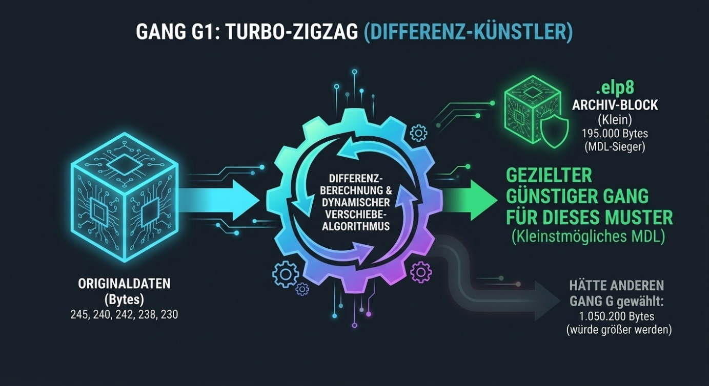

*Abbildung 2.7: Gang G1 – Turbo-ZigZag (Der universelle Differenz-Künstler) im Überblick – Durch gezielte Differenzberechnung und dynamische Verschiebung verwandelt EULNO zusammenhängende Rohdaten in einen hochgradig komprimierbaren Strom kleiner Abweichungen und erzielt den kleinstmöglichen Block für das .elp8-Archiv.*

Wie genau das funktioniert, zeigen drei einfache Beispiele aus dem Alltag

Stell dir vor, du fährst mit dem Auto gleichmäßig auf der Autobahn und notierst alle 6 Minuten deinen Kilometerstand: 10 km, 20 km, 30 km, 40 km (du fährst also exakt 100 km/h). Statt diese immer größer werdenden Kilometerstände abzuspeichern, notierst du einfach nur, wie weit du seit der letzten Messung gefahren bist (die konstante Geschwindigkeit, Ordnung k = 1): +10, +10, +10. Aus steigenden Zahlen wird eine langweilige Reihe gleicher Zahlen – ein Traum für jede Kompression!

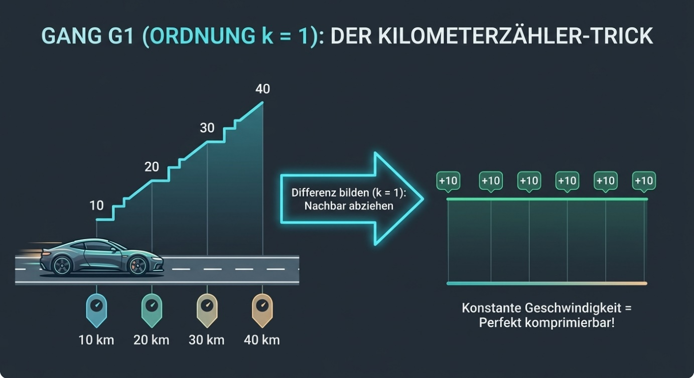

*Abbildung 2.8: Gang G1 (Ordnung k = 1) – Das Kilometerzähler-Prinzip: Statt ständig wachsende Kilometerstände (10 km, 20 km, 30 km, 40 km) in festen Zeitabständen zu speichern, notiert EULNO nur die zurückgelegte Strecke zum Vorgänger (+10, +10, +10) und verwandelt eine steigende Treppe in eine flache Linie.*

Was aber, wenn du gleichmäßig Gas gibst, sodass deine Weg-Zeit-Linie auf dem Diagramm wie eine sanft ansteigende Kurve verläuft (Ordnung k = 2)? Nehmen wir die Messreihe: 10, 12, 16, 22.

– Beim ersten Abziehen (Geschwindigkeit) erhalten wir: 2, 4, 6 (wird noch größer).

– Ziehen wir jetzt ein zweites Mal ab (Beschleunigung / Krümmung), erhalten wir: 2, 2! Plötzlich ist auch die geschwungene Kurve völlig flach!

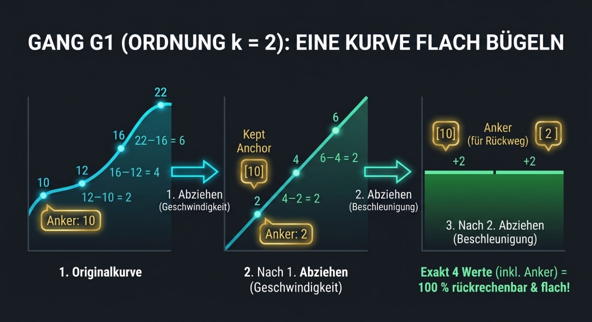

*Abbildung 2.9: Gang G1 (Ordnung k = 2) – Eine Kurve flach bügeln: Durch zweifaches Abziehen wird aus der ansteigenden Weg-Zeit-Kurve (10, 12, 16, 22) über die Geschwindigkeit (2, 4, 6) eine völlig flache Linie (+2, +2), während die beiden gespeicherten Anfangswerte (Anker 10 und 2) die bitgenaue Rückrechnung sichern.*

Doch wie findet EULNO beim Entpacken aus diesen flachen Zahlen wieder exakt zur ursprünglichen Kurve zurück? Indem der Decoder den Vorgang einfach umdreht und die gespeicherten Werte mithilfe der beiden Anfangsanker (10 und 2) zweimal hintereinander wieder aufsummiert:

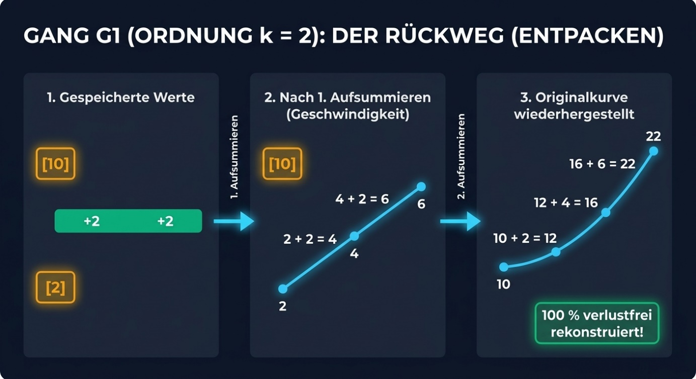

*Abbildung 2.10: Gang G1 (Ordnung k = 2) – Der Rückweg (Entpacken): Aus den beiden gespeicherten Ankern ([10] und [2]) sowie den flachen Abständen (+2, +2) baut EULNO durch zweifaches Aufsummieren zuerst die Geschwindigkeit (2, 4, 6) und anschließend bitgenau die ursprüngliche Kurve (10, 12, 16, 22) wieder auf.*

Doch in einer echten Datei liegen verwandte Zahlen nicht immer direkt nebeneinander. Stell dir einen mehrdimensionalen Datenblock (etwa ein Foto, ein 3D-Modell oder eine KI-Matrix) wie einen Zauberwürfel vor, der aus vielen einzelnen Reihen und hintereinanderliegenden Scheiben besteht. Da der Arbeitsspeicher eines Computers jedoch nur eine einzige lange Linie kennt, werden alle Reihen und Scheiben des Würfels im Speicher wie ein langes Maßband hintereinander ausgerollt. Damit EULNO trotzdem sowohl nach links (Abstand s = 1), nach oben (s = 32) als auch eine ganze 3D-Schicht nach hinten (s = 512 oder 1024) schauen kann, probiert Gang G1 verschiedene Sprungweiten s aus.

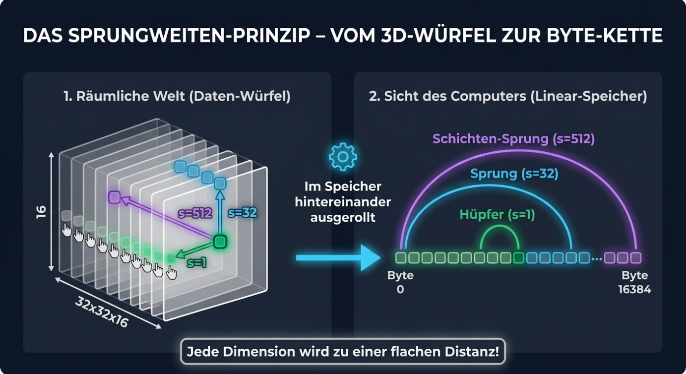

*Abbildung 2.11: Das Sprungweiten-Prinzip (Strided Memory) – Links: Ein räumlicher 3D-Datenwürfel mit Nachbarn in der Breite (s = 1), Höhe (s = 32) und Tiefe (s = 512). Rechts: Im linearen Computerspeicher liegen alle Bytes hintereinander wie auf einem Maßband, sodass EULNO durch gezielte Sprungweiten (s) dreidimensional durch die Datei hindurchblicken kann.*

Damit der Entpacker später nicht raten muss, welche Sprungweite s und wie viele Rechenstufen k beim Packen verwendet wurden, legt EULNO dem komprimierten Block einen winzigen Bauplan vorne an den Anfang: einen 3-Byte-Steckbrief (2 Bytes für die Sprungweite s, 1 Byte für die Ordnung k) sowie die allerersten s · k Startwerte als unveränderte Anker. Erst dahinter folgen die flach gerechneten Differenzen. So hat der Decoder beim Öffnen sofort alle Startpunkte und die exakte Bauanleitung griffbereit in der Hand.

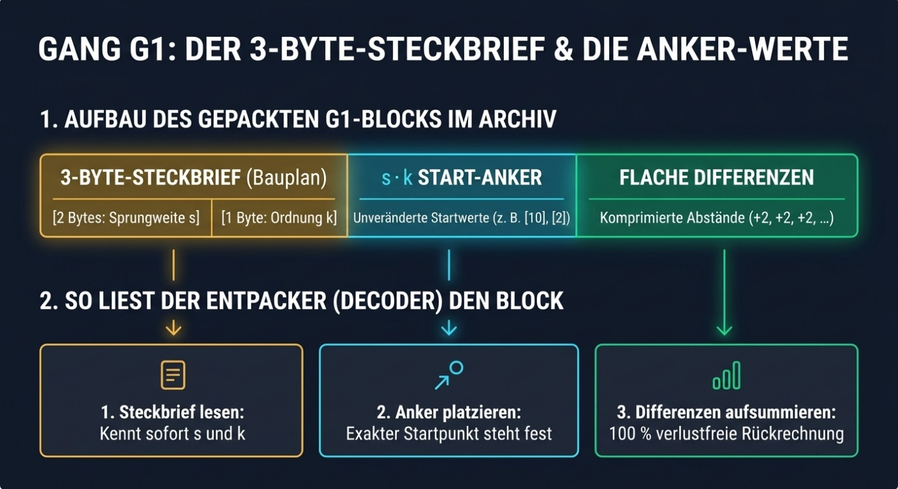

*Abbildung 2.12: Gang G1 – Der 3-Byte-Steckbrief & die Anker-Werte (Block-Aufbau) – Oben: Jeder gepackte G1-Block beginnt mit einem 3-Byte-Steckbrief (Sprungweite s und Ordnung k) sowie den unveränderten s · k Start-Ankern, gefolgt von den flachen Differenzen. Unten: So liest der Entpacker diesen Bauplan Schritt für Schritt aus, um den Block bitgenau wiederherzustellen.*

Und damit beim Abziehen und Wieder-Aufzählen niemals ein Wert ins Negative rutscht oder über die Byte-Grenze von 255 hinauswächst, laufen sämtliche Rechenschritte von Gang G1 im Hintergrund geschlossen auf unserer 256-Stunden-Uhr (ℤ/256ℤ) ab. Ganz gleich, wie oft EULNO die Differenzen beim Packen bildet: Beim Entpacken dreht der Decoder den Zeiger auf demselben Zifferblatt einfach wieder um exakt dieselben Schritte vorwärts und stellt so jedes einzelne Byte bitgenau wieder her.

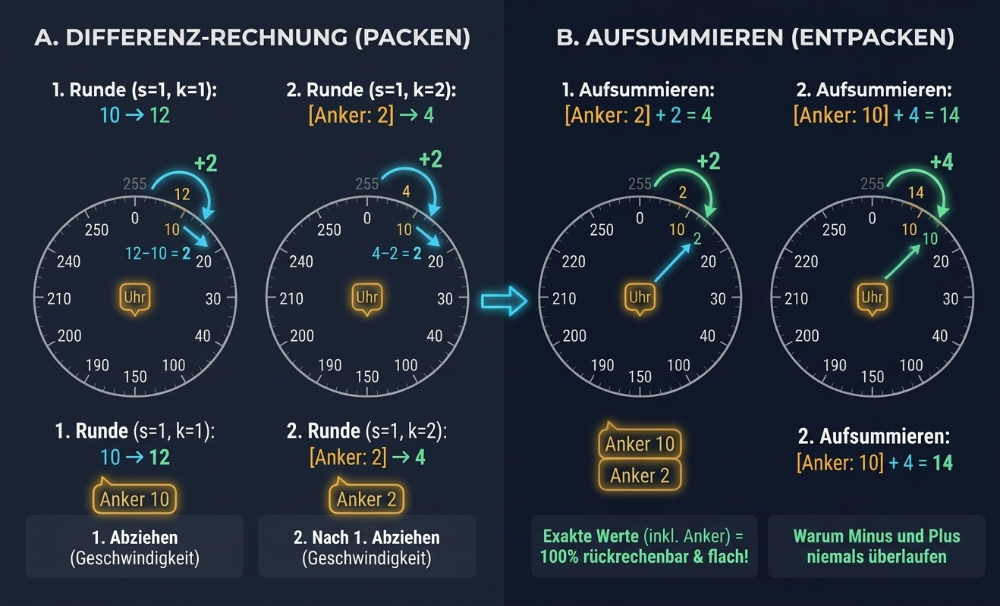

*Abbildung 2.13: Gang G1 auf der 256-Stunden-Uhr (ℤ/256ℤ) – Links (Packen): Alle Differenz-Schritte (k = 1 und k = 2) laufen geschlossen auf dem Zifferblatt von 0 bis 255 ab, sodass niemals negative Zahlen oder Überläufe entstehen. Rechts (Entpacken): Beim Zurückrechnen wandert der Zeiger mithilfe der gespeicherten Anker um exakt dieselben Schritte vorwärts und stellt jeden ursprünglichen Byte-Wert bitgenau wieder her.*

- **Gang G2 – Hex-Nibble-Sortierung (64er-Spalten-Trick)**
Jedes Byte (8 Lichtschalter) lässt sich sauber in zwei halbe Bytes zu je 4 Lichtschaltern teilen – sogenannte Nibbles (Werte von 0 bis 15). EULNO legt diese Halb-Bytes in eine Tabelle mit 64 Spalten und liest sie dann nicht mehr zeilenweise, sondern spaltenweise von oben nach unten aus. Warum? Weil in Computerdateien oder KI-Tabellen oft an genau derselben Spaltenposition immer wieder dieselben Vorzeichen- oder Exponenten-Bits stehen. Durch das Spaltenlesen stehen plötzlich hunderte gleiche Werte direkt hintereinander! Beim Entpacken wird die Tabelle einfach wieder zurückgedreht.

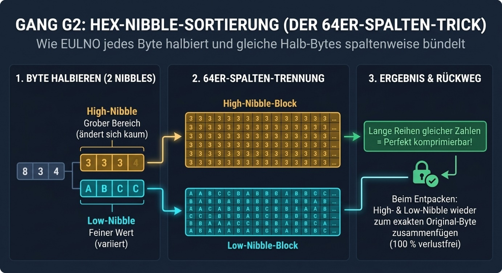

*Abbildung 2.14: Gang G2 – Hex-Nibble-Sortierung (Der 64er-Spalten-Trick) – EULNO halbiert jedes Byte in sein grobes High-Nibble und feines Low-Nibble und sortiert sie in 64 Spalten untereinander, sodass gleiche Halb-Bytes zu langen, hochkomprimierbaren Reihen gebündelt werden.*

Doch wie merkt sich EULNO in der gepackten Datei, welche Halb-Bytes zusammengehören, ohne dabei zusätzlichen Speicherplatz zu verschwenden? Ganz einfach: Da zwei 4-Bit-Halb-Bytes zusammen wieder exakt ein volles 8-Bit-Byte ergeben, klebt EULNO jeweils zwei sortierte High-Nibbles zu einem neuen Byte zusammen – und direkt dahinter jeweils zwei sortierte Low-Nibbles. Die Gesamtmenge der Bytes bleibt vor dem eigentlichen Packen also exakt gleich (erste Hälfte: alle High-Nibbles, zweite Hälfte: alle Low-Nibbles). Im winzigen Block-Kopf des .elp8-Archivs notiert EULNO lediglich den Vermerk „Gang G2“ sowie die ursprüngliche Blocklänge N. Beim Entpacken teilt der Decoder den Strom genau in der Mitte, sortiert die 64er-Spalten wieder zurück und fügt jedes High- und Low-Nibble bitgenau zu seinem ursprünglichen Byte zusammen.

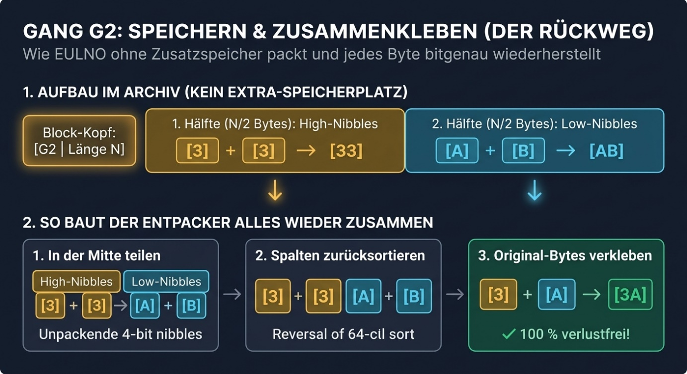

*Abbildung 2.15: Gang G2 – Speichern & Zusammenkleben (Der Rückweg) – Oben: Im Archiv werden jeweils zwei sortierte High-Nibbles (erste Hälfte N/2) und zwei Low-Nibbles (zweite Hälfte N/2) ohne Zusatzspeicher zu vollen Bytes verklebt und über den Block-Kopf [G2 | Länge N] markiert. Unten: Beim Entpacken teilt der Decoder den Strom genau in der Mitte, sortiert die 64er-Spalten zurück und fügt jedes High- und Low-Nibble bitgenau zu seinem ursprünglichen Byte zusammen.*

- **Gang G3 – Der 3D-Tetraeder-Raum (Sparse-rANS - Der räumliche Block-Sortierer)**
Viele moderne Dateien – von 3D-Modellen und medizinischen Schichtaufnahmen bis hin zu den inneren Zahlenräumen künstlicher Intelligenzen (dem sogenannten Latent Space) – sind nicht eindimensional wie ein langer Satz aufgebaut, sondern besitzen eine echte räumliche Struktur entlang mehrerer Achsen (Breite X, Höhe Y und Tiefe Z). Würde ein Packprogramm solche Daten einfach stur Zeile für Zeile ablesen, würden räumlich eng benachbarte Werte auseinandergerissen. Gang G3 betrachtet den Datenblock deshalb als dreidimensionales Gebilde und sortiert zusammengehörige Nachbarn im Raum neu, bevor die eigentliche Verdichtung beginnt.

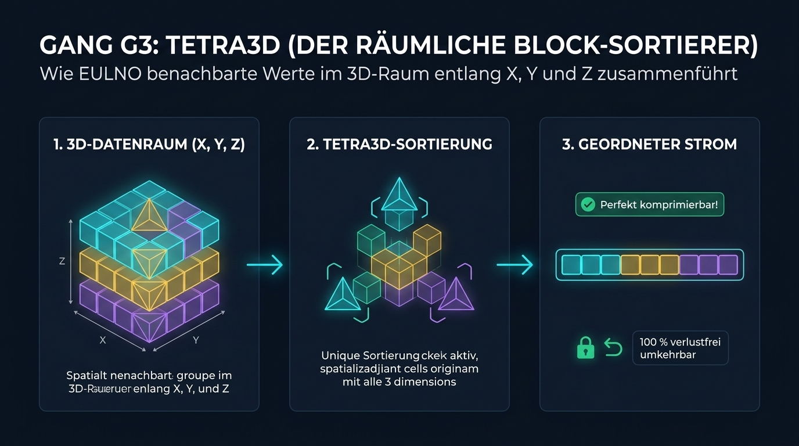

*Abbildung 2.16: Gang G3 – Tetra3D (Der räumliche Block-Sortierer) im Überblick – EULNO überführt den Datenblock in einen dreidimensionalen Koordinatenraum (X, Y, Z), bündelt räumlich benachbarte Werte über Tetraeder-Gruppen und erzeugt daraus einen hochgradig geordneten, 100 % verlustfrei umkehrbaren Datenstrom.*

1. Der 3D-Datenraum & die Brücke zum KI-Latentraum (X, Y, Z)

Stell dir einen Würfel aus vielen kleinen Bausteinen (Voxeln) vor – genau wie bei einem 3D-Druckmodell oder den übereinanderliegenden Schichten einer Computer-Tomografie. Auch moderne KI-Modelle speichern ihr Wissen in genau solchen mehrdimensionalen Zahlenräumen (Tensoren und Latent-Räumen), in denen verwandte Merkmale wie „Farbe“, „Form“ oder „Bedeutung“ räumlich nah beieinanderliegen. Da der Arbeitsspeicher eines Computers jedoch nur eine einzige flache Byte-Kette kennt, faltet Gang G3 diesen eindimensionalen Strom im ersten Schritt virtuell in ein dreidimensionales Koordinatengitter aus Breite (X), Höhe (Y) und Tiefe (Z) zurück. So wird sofort sichtbar, welche Werte im Raum tatsächlich direkte Nachbarn sind.

*Abbildung 2.17: Vom einzelnen Voxel zur 4-Punkt-Pyramide (Tetraeder) – Ein Voxel ist das dreidimensionale Gegenstück zu einem Bildpunkt (Pixel). Indem EULNO ein Voxel mit seinen drei direkten Nachbarn entlang der Breite (X), Höhe (Y) und Tiefe (Z) verbindet, entsteht eine kompakte 4-Punkt-Pyramide (Tetraeder), die alle drei Raumrichtungen gleichzeitig erfasst.*

Doch warum wählt EULNO ausgerechnet eine Pyramide mit genau vier Eckpunkten – und keinen kleinen Würfel mit acht Punkten? Dahinter steckt ein einfaches, aber entscheidendes Gesetz der Geometrie:

- **Für eine eindimensionale Linie genügen 2 Punkte.**
- **Für eine flache zweidimensionale Ebene genügen 3 Punkte (ein Dreieck).**
- **Für einen echten dreidimensionalen Raum braucht man mindestens 4 Punkte, die nicht auf derselben Fläche liegen – genau unsere 4-Punkt-Pyramide (das Tetraeder).**
Ein kleiner Würfel mit 8 Eckpunkten wäre doppelt so groß und würde feine Kanten oder Übergänge in einem 3D-Modell oder KI-Raum bereits unnötig verwischen. Die 4-Punkt-Pyramide ist dagegen das kleinstmögliche 3D-Werkzeug der Mathematik: Sie greift mit minimalem Aufwand gleichzeitig in Breite, Höhe und Tiefe und hält zusammengehörige Nachbarn so eng und scharf wie möglich beieinander.

*Abbildung 2.18: Gang G3 – Vom 3D-Block zur geordneten Reihe – EULNO zerlegt den gesamten dreidimensionalen Datenwürfel in 4-Punkt-Pyramiden (Tetraeder), bündelt räumlich verwandte Nachbarn entlang X, Y und Z zusammen und reiht sie zu einer glatten, hochkomprimierbaren Byte-Folge auf.*

Da jede 4-Punkt-Pyramide nach einer streng deterministischen Koordinaten-Regel (X, Y, Z) gebildet wird, muss EULNO keine einzelnen Positionstabellen mitspeichern: Beim Entpacken setzt der Decoder die geordnete Byte-Folge anhand der im Block-Kopf hinterlegten Raummaße wieder exakt an ihre ursprünglichen Voxel-Plätze im 3D-Würfel zurück.

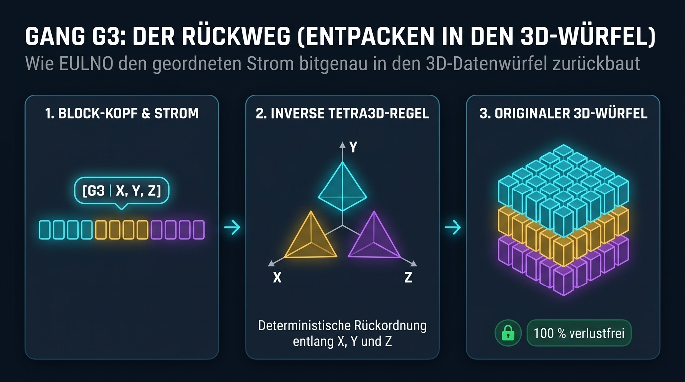

*Abbildung 2.19: Gang G3 – Der Rückweg (Entpacken in den 3D-Würfel) – Anhand der im Block-Kopf hinterlegten Standard-Rastermaße [G3 | X, Y, Z] führt der Decoder die sortierte Byte-Folge über die umgekehrte Tetra3D-Regel wieder exakt an ihre ursprünglichen Voxel-Plätze im 3D-Datenwürfel zurück – 100 % verlustfrei und ohne Positionstabellen.*

Doch wie genau sieht diese „streng deterministische Koordinaten-Regel“ aus? Stell dir den 3D-Datenwürfel wie einen großen Gebäudekomplex aus vielen kleinen 2×2×2-Zimmer-Würfeln vor. Für jedes dieser kleinen Zimmer gilt im EULNO-Bauplan eine feste, unveränderliche Laufnummern-Schablone: Zuerst werden die vier Ecken der ersten Pyramide nach einem festen Koordinaten-Schema eingesammelt (zum Beispiel Ecke (0,0,0), Ecke (1,1,0), Ecke (1,0,1) und Ecke (0,1,1)) und direkt dahinter die vier gegenüberliegenden Ecken der zweiten Pyramide. Weil sowohl der Packer als auch der Entpacker exakt dieselbe Laufnummern-Schablone fest in ihrem Programmcode tragen, braucht EULNO keine einzige Positionstabelle mitzuspeichern.

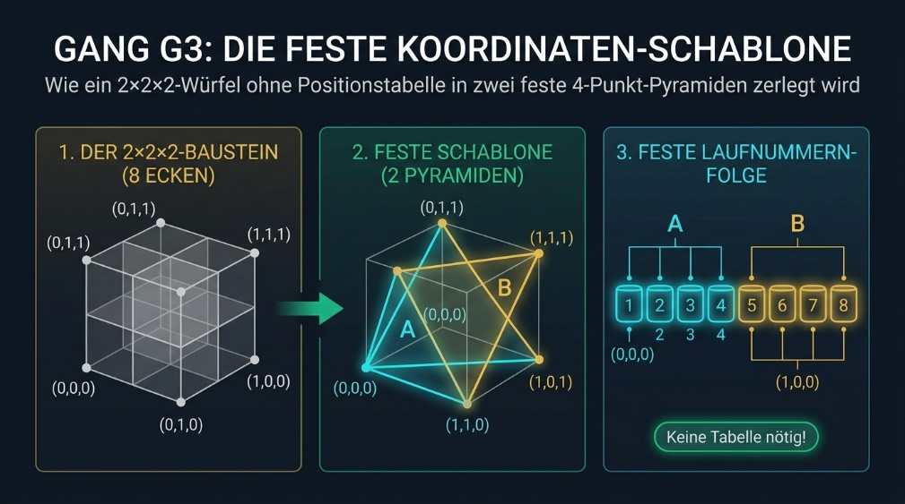

*Abbildung 2.20: Gang G3 – Die feste Koordinaten-Schablone im 2×2×2-Würfel – Jeder kleine 2×2×2-Baustein (8 Voxel) wird nach einer unveränderlichen Bauplan-Regel in zwei komplementäre 4-Punkt-Pyramiden zerlegt (Pyramide A: (0,0,0), (1,1,0), (1,0,1), (0,1,1) und Pyramide B: die 4 gegenüberliegenden Ecken). Weil Packer und Entpacker dieselbe Schablone im Programmcode tragen, wird keine einzige Positionstabelle benötigt.*

Da EULNO bei mehrdimensionalen Blöcken feste, effiziente Standard-Rastermaße (Geometrie-Kandidaten X, Y, Z) prüft und jede 4-Punkt-Pyramide nach einer streng deterministischen Koordinaten-Regel bildet, muss keine einzige Positionstabelle mitgespeichert werden – eventuelle Rand- oder Rest-Bytes, die kein vollständiges Tetraeder mehr füllen, werden einfach unverändert am Blockende mitgeführt. Beim Entpacken setzt der Decoder die geordnete Byte-Folge anhand der im Block-Kopf hinterlegten Raummaße [G3 | X, Y, Z] wieder exakt an ihre ursprünglichen Voxel-Plätze im 3D-Würfel zurück.

Doch warum spart allein dieses geschickte Umsortieren am Ende tatsächlich Speicherplatz? Ganz einfach: Gang G3 verändert die Zahlen selbst noch gar nicht, sondern sorgt wie ein guter Bibliothekar für perfekte Ordnung im Regal. Wenn die vier Ecken einer Pyramide im echten 3D-Objekt oder KI-Modell räumlich direkt beieinanderliegen, haben sie fast immer sehr ähnliche oder sogar identische Werte (zum Beispiel ähnliche Farb-, Helligkeits- oder Gewichtswerte). Indem EULNO diese vier Nachbarn im Datenstrom direkt hintereinanderstellt, entstehen lange, ruhige Ketten aus fast gleichen Zahlen. Genau solche ruhigen Ketten lassen sich im direkt anschließenden finalen Kompressionsschritt auf einen winzigen Bruchteil ihrer ursprünglichen Größe eindampfen – während das vorherige Durcheinander kaum geschrumpft wäre.

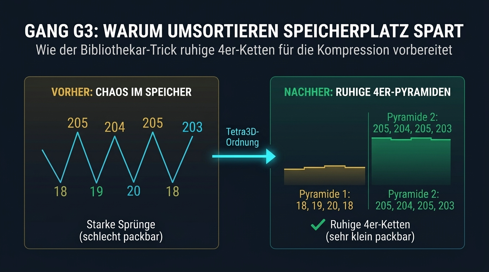

*Abbildung 2.21: Gang G3 – Warum Umsortieren Speicherplatz spart (Der Bibliothekar-Trick) – Links: Im unsortierten Speicher springen die acht Werte wild auf und ab (18, 205, 19, 204, 20, 205, 18, 203) und lassen sich schlecht verdichten. Rechts: Durch die Tetra3D-Ordnung stehen die jeweils vier räumlich benachbarten Ecken einer Pyramide direkt hintereinander (Pyramide 1: 18, 19, 20, 18 und Pyramide 2: 205, 204, 205, 203) – diese ruhigen 4er-Ketten lassen sich anschließend auf einen Bruchteil ihrer Größe eindampfen.*

- **Gang G4 – Bit-Ebenen-Röntgenblick (Das Pascalsche Dreieck)**
Manche Datenblöcke – etwa aus wissenschaftlichen Messreihen, Sensoren oder fein abgestuften KI-Gewichten – wirken auf den ersten Blick wie eine bunte Folge unterschiedlicher Zahlen. Doch wenn man sie wie unter einem Röntgengerät Schicht für Schicht durchleuchtet, zeigt sich oft eine erstaunliche Ruhe in den einzelnen Bits. Genau das nutzt Gang G4 aus: EULNO trennt die acht Lichtschalter jedes Bytes in acht eigenständige Folien auf und verwandelt dünn besetzte Bit-Zeilen mithilfe des berühmten Pascalschen Dreiecks verlustfrei in winzige Kombinatorik-Platznummern.

1. Der Röntgenblick: Warum 8 durchsichtige Folien plötzlich Ruhe in die Zahlen bringen

Erinnere dich an unser Bild aus Kapitel 1: Jedes Byte besteht aus 8 Lichtschaltern (Bits) von links (Bit 7, dem großen 128er-Schalter) bis rechts (Bit 0, dem kleinen 1er-Schalter). Wenn sich Zahlen in einer Datei nur leicht verändern – zum Beispiel 12, 14, 13, 15 –, wechselt auf der Anzeige ständig der Gesamtwert. Doch schaut man sich die einzelnen Schalterpositionen getrennt an, passiert etwas Verblüffendes: Die oberen Schalter bleiben über hunderte Bytes hinweg völlig unverändert auf AUS (0). EULNO legt deshalb alle ersten Schalter auf Folie 7, alle zweiten auf Folie 6 und so weiter bis hinunter zu Folie 0. Zusätzlich vergleicht EULNO auf jeder Folie jede neue Zeile mit der vorherigen (per XOR-Unterschied), sodass selbst eine Folie voller Einsen sofort zu einer ruhigen Fläche aus fast reinen Nullen wird.

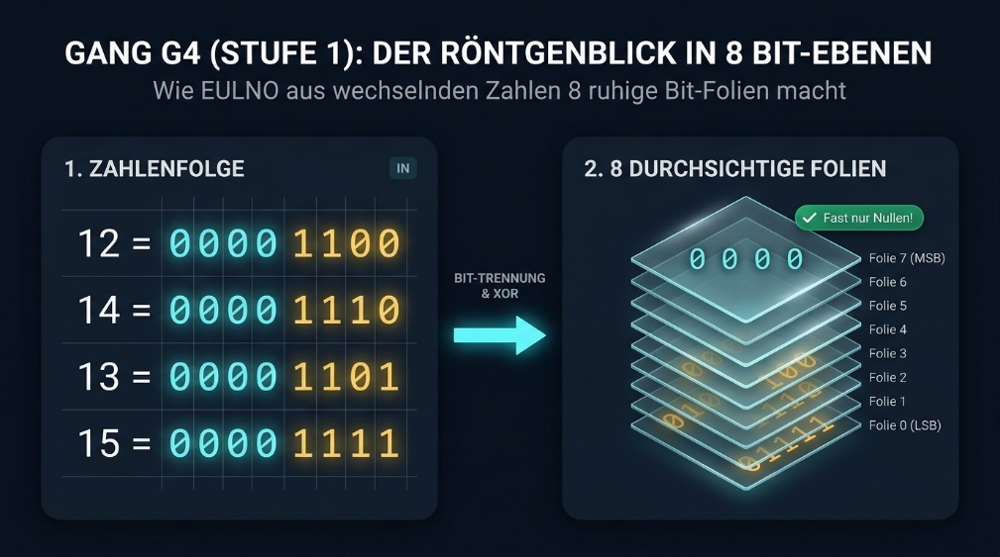

*Abbildung 2.22: Gang G4 (Stufe 1) – Der Röntgenblick in 8 Bit-Ebenen – Während sich bei der Zahlenfolge 12, 14, 13, 15 der Gesamtwert ständig ändert, bleiben die oberen Schalter (Folie 7 bis Folie 4) komplett auf 0 stehen. Durch das Auftrennen in acht durchsichtige Bit-Folien isoliert EULNO die ruhigen Schichten von den unruhigen unteren Bits.*

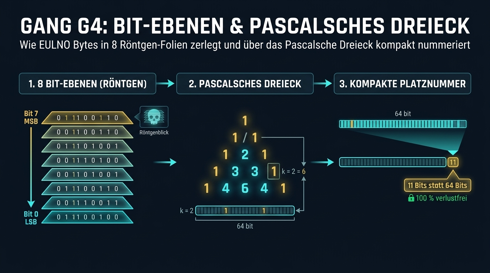

*Abbildung 2.23: Gang G4 – Bit-Ebenen & Pascalsches Dreieck (Der Röntgenblick) im Überblick – EULNO zerlegt jedes Byte wie durch Röntgen-Folien in acht einzelne Bit-Ebenen (Bit 7 bis Bit 0) und wandelt dünn besetzte 64-Bit-Zeilen mithilfe des Pascalschen Dreiecks verlustfrei in eine winzige Kombinatorik-Platznummer um (z. B. 11 Bits statt 64 Bits).*

2. Das Pascalsche Dreieck: Ein jahrhundertealtes Zahlendreieck als Kompressions-Wunder

Bevor wir sehen, wie EULNO diese ruhigen Bit-Folien schrumpft, lohnt sich ein Blick auf eines der faszinierendsten Werkzeuge der gesamten Mathematik: das Pascalsche Dreieck, benannt nach dem französischen Mathematiker Blaise Pascal im 17. Jahrhundert, dessen Muster bereits Jahrhunderte zuvor in Indien, Persien und China entdeckt wurden.

Das Bauprinzip hinter diesem großen Namen ist dabei verblüffend zugänglich – man braucht dafür weder höhere Mathematik noch einen Taschenrechner, sondern lediglich einfaches Zusammenzählen: Man beginnt ganz oben an der Spitze mit einer 1 und setzt an den linken und rechten Außenrand ebenfalls immer eine 1. Jede Zahl im Inneren entsteht einfach dadurch, dass man die beiden Zahlen direkt schräg darüber addiert:

- **Spitze:** 1
- **Reihe 1:** 1   1
- **Reihe 2:** 1   2   1   (denn 1 + 1 = 2)
- **Reihe 3:** 1   3   3   1   (denn 1 + 2 = 3 und 2 + 1 = 3)
- **Reihe 4:** 1   4   6   4   1   (denn 1 + 3 = 4, 3 + 3 = 6 und 3 + 1 = 4)

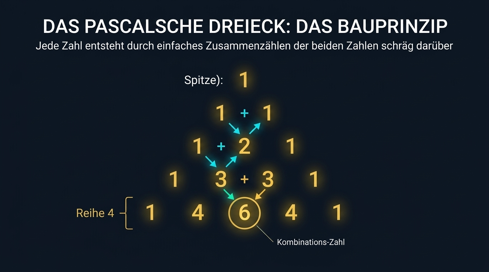

*Abbildung 2.24: Das Pascalsche Dreieck – Die Zählweise ab Null – Links: Mathematiker zählen die Spitze als Reihe 0, sodass Reihe 4 die fünfte Zeile von oben ist (1 – 4 – 6 – 4 – 1). Rechts: Auch innerhalb einer Reihe beginnt die Zählung links bei Position 0 (0 von 4 Schaltern), sodass Position 2 in der Mitte die Zahl 6 liefert (exakt 6 Möglichkeiten für 2 von 4 Schaltern).*

Doch warum ist dieses harmlos wirkende Zahlendreieck für die Informatik so wertvoll? Es verrät ohne jede komplizierte Multiplikation sofort, wie viele Möglichkeiten es gibt, aus einer Reihe von Schaltern eine bestimmte Anzahl einzuschalten. Wichtig ist dabei nur ein kleiner Trick beim Abzählen: Mathematiker beginnen sowohl von oben (bei der Spitze) als auch von links immer bei der Null zu zählen.

Schau unter dieser Zählweise in Reihe 4 (die fünfte Zeile von oben: 1 – 4 – 6 – 4 – 1) auf die Zahl 6 genau in der Mitte:

- **Ganz links (Position 0):** 1 Möglichkeit, 0 von 4 Schaltern einzuschalten (alle AUS).
- **Zweite Zahl (Position 1):** 4 Möglichkeiten, genau 1 von 4 Schaltern einzuschalten.
- **In der Mitte (Position 2):** Exakt 6 verschiedene Möglichkeiten, genau 2 von 4 Schaltern einzuschalten!
Und genau diese Eigenschaft nutzt EULNO, um aus einer langen 64-Bit-Zeile eine winzige Platznummer zu berechnen.

Schauen wir uns genau diese Zahl 6 aus Reihe 4 in der Praxis an: Stell dir eine kleine Reihe mit 4 Lichtschaltern vor, von denen genau 2 eingeschaltet sind (1 = AN, 0 = AUS). Das Pascalsche Dreieck verrät nicht nur sofort, dass es exakt 6 verschiedene Muster gibt – es erlaubt es EULNO auch, jedes dieser Muster eindeutig von Platz 1 bis Platz 6 durchzunummerieren:

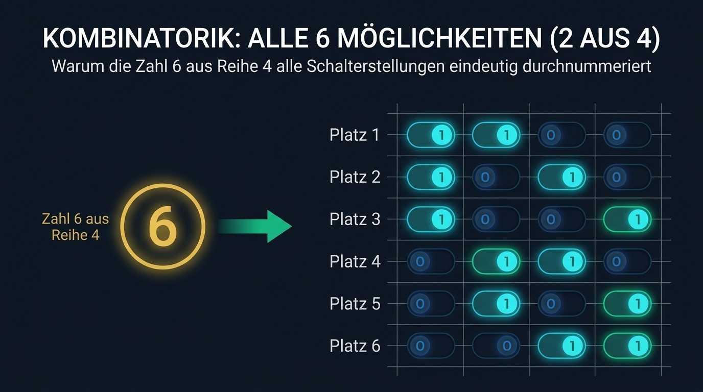

*Abbildung 2.25: Kombinatorik – Alle 6 Möglichkeiten („2 aus 4“) im Überblick – Die Zahl 6 aus Reihe 4 des Pascalschen Dreiecks zeigt, dass es exakt sechs verschiedene Kombinationen gibt, 2 von 4 Schaltern einzuschalten. Statt alle vier Schalter einzeln zu speichern, merkt sich EULNO einfach nur deren eindeutige Platznummer (Platz 1 bis Platz 6).*

3. Der große Maßstab: Wie aus 64 Bits 11 Bits werden – und wieder bitgenau zurück

Genau dieses Prinzip überträgt EULNO nun auf die ruhigen Bit-Folien aus Stufe 1 – nur in einem größeren Maßstab: Statt 4 Schalter betrachtet Gang G4 jeweils 64 Bits einer Folie auf einmal. Zählt EULNO in einer solchen 64-Bit-Zeile zum Beispiel nur k = 2 eingeschaltete Einsen, verrät Reihe 64 des Pascalschen Dreiecks sofort, dass es dafür genau 2.016 mögliche Schalterstellungen gibt.

- **Beim Komprimieren (Packen):** Statt alle 64 Bits einzeln abzuspeichern, notiert EULNO lediglich die Anzahl der Einsen (k = 2, benötigt 7 Bits) und die eindeutige Kombinatorik-Platznummer dieses Musters. Weil sich alle 2.016 möglichen Plätze mit nur 11 Bits durchnummerieren lassen (2¹¹ = 2.048), schrumpft die Platznummer einer kompletten 64-Bit-Zeile auf kompakte 11 Bits zusammen (insgesamt 18 statt 64 Bits – eine Ersparnis von über 71 Prozent, ganz ohne jede Schätzung).
- **Beim Dekomprimieren (Entpacken):** Der Entpacker liest die Anzahl k und die gespeicherte Platznummer und schlägt im Pascalschen Dreieck einfach den zugehörigen Kombinatorik-Pfad wieder nach. So setzt er jede einzelne 1 und jede 0 bitgenau wieder an ihre ursprüngliche Position in der 64-Bit-Zeile zurück, bevor die acht Bit-Folien wieder zu den exakten Original-Bytes verschmolzen werden.

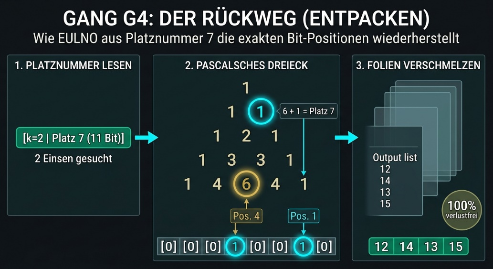

*Abbildung 2.26: Gang G4 – Der Rückweg (Entpacken aus der Platznummer) – Links: Der Entpacker liest die Anzahl der Einsen (k = 2) und die kompakte 11-Bit-Platznummer aus. Mitte: Über das Pascalsche Dreieck schlägt er die exakten Positionen der Einsen nach und stellt die vollständige 64-Bit-Zeile bitgenau wieder her. Rechts: Anschließend werden die acht rekonstruierten Bit-Folien wieder zu den ursprünglichen Original-Bytes (12, 14, 13, 15) verschmolzen.*

Vielleicht fragst du dich jetzt: Wie riesig muss dieses Pascalsche Dreieck im Computer eigentlich sein, um alle Möglichkeiten einer 64-Bit-Zeile abzudecken? Die Antwort ist überraschend bescheiden: Das Dreieck besteht aus genau 65 Reihen (Reihe 0 bis Reihe 64) mit insgesamt 2.145 einzelnen Zahlen – und belegt im Arbeitsspeicher winzige 17 Kilobyte, also weniger Platz als ein einziges kleines Symbolbild. Und trotzdem steckt darin gewaltige Rechenkraft: Während ganz außen immer Einsen stehen (für „alle Schalter AUS“ oder „alle Schalter AN“), verrät die Zahl genau in der Mitte von Reihe 64 („32 aus 64“), dass es über 1,83 Trillionen verschiedene Möglichkeiten gibt, genau die Hälfte der 64 Schalter einzuschalten – und EULNO findet jede beliebige dieser Kombinationen in wenigen Nanosekunden.

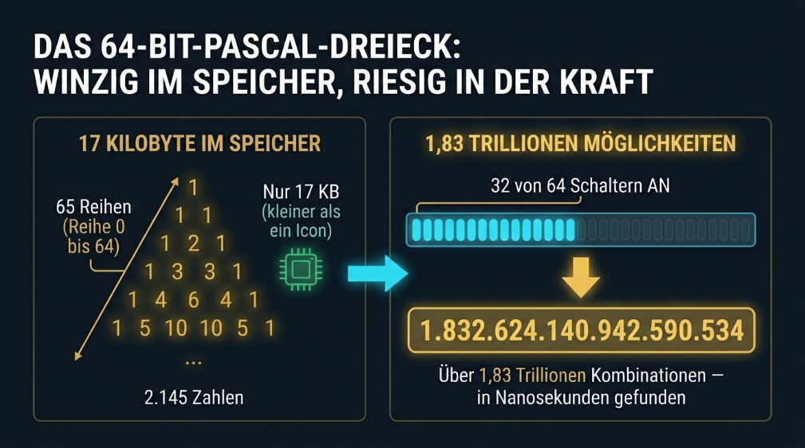

*Abbildung 2.27: Das 64-Bit-Pascal-Dreieck – Winzig im Speicher, riesig in der Kraft – Links: Das vollständige Dreieck bis Reihe 64 (65 Reihen mit 2.145 Zahlen) belegt im Arbeitsspeicher nur 17 Kilobyte – weniger Platz als ein kleines Symbolbild. Rechts: Dennoch umfasst allein die mittlere Position („32 von 64 Schaltern AN“) exakt 1.832.624.140.942.590.534 (über 1,83 Trillionen) mögliche Kombinationen, die EULNO in wenigen Nanosekunden exakt nachschlägt.*

- **Gang G5 – Das Kurzzeitgedächtnis (MTF + 3D-Tetraeder)**
Viele Dateien – etwa Texte, Programmcodes, Datenbank-Tabellen oder strukturierte Protokolle – bestehen nicht aus sanften Zahlenwellen, sondern aus einem begrenzten Vorrat an Zeichen und Byte-Werten, die immer wieder in kurzen Abständen auftauchen. Genau für solche Fälle besitzt EULNO ein eingebautes Kurzzeitgedächtnis: Gang G5 kombiniert das sogenannte Move-To-Front-Verfahren (MTF) mit unserem bereits bekannten 3D-Tetraeder-Motor. Häufig genutzte Werte wandern wie auf einem Bücherstapel blitzschnell nach ganz oben auf Platz 0, wodurch ein unruhiger Datenstrom in eine lange Reihe aus Nullen verwandelt und anschließend räumlich hochverdichtet wird.

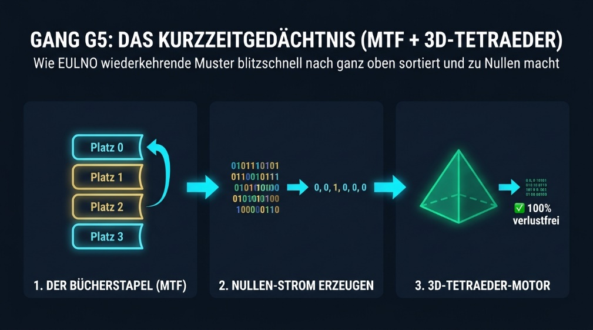

*Abbildung 2.28: Gang G5 – Das Kurzzeitgedächtnis (MTF + 3D-Tetraeder) im Überblick – EULNO sortiert häufig auftretende Byte-Werte nach dem Move-To-Front-Prinzip wie auf einem Bücherstapel nach ganz oben auf Platz 0 (1), verwandelt die Daten dadurch in einen ruhigen Strom aus Nullen (2) und verdichtet diesen anschließend über den 3D-Tetraeder-Motor (3) 100 % verlustfrei.*

1. Der Bücherstapel in Aktion: Wie aus bunten Zeichen Nullen werden

Stell dir auf deinem Schreibtisch einen ordentlichen Bücherstapel vor. In der echten EULNO-Engine liegen auf diesem Stapel alle 256 möglichen Byte-Werte (von 0 bis 255) fein säuberlich der Reihe nach geordnet – zur Veranschaulichung genügt hier ein kleiner Stapel aus vier Büchern (A auf Platz 0, B auf Platz 1, C auf Platz 2 und D auf Platz 3).

Liest EULNO nun die Zeichenfolge „B, B, B, A“ ein, passiert Folgendes:

- **Erstes „B“:** EULNO schaut nach, wo Buch B liegt (auf Platz 1), notiert sich die Zahl 1 und legt Buch B anschließend ganz oben auf Platz 0 (Buch A rutscht dadurch auf Platz 1).
- **Zweites und drittes „B“:** Da Buch B jetzt bereits ganz oben auf Platz 0 liegt, notiert EULNO zweimal hintereinander schlicht die 0!
- **Darauf folgendes „A“:** Buch A wartet direkt darunter auf Platz 1 – EULNO notiert also die 1 und holt Buch A wieder nach ganz oben.
Aus der Buchstabenfolge „B, B, B, A“ ist so die kompakte Zahlenreihe „1, 0, 0, 1“ geworden. Je öfter sich bestimmte Werte oder Muster in einer Datei abwechseln oder wiederholen, desto länger werden die Ketten aus Nullen und Einsen – ein ideales Futter für die anschließende Verdichtung.

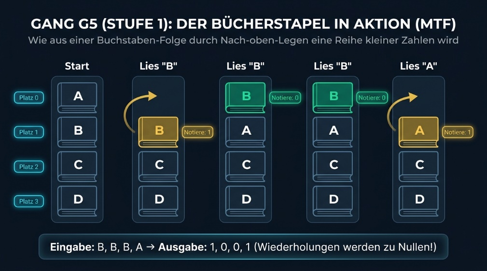

*Abbildung 2.29: Gang G5 (Stufe 1) – Der Bücherstapel in Aktion (Move-To-Front) – Ausgehend vom geordneten Startstapel (A, B, C, D auf den Plätzen 0 bis 3) notiert EULNO für jedes gelesene Zeichen dessen aktuelle Platznummer und legt es sofort nach ganz oben auf Platz 0. Aus „B, B, B, A“ entsteht so die ruhige Zahlenfolge „1, 0, 0, 1“.*

2. Das Doppel-Gespann (MTF + 3D-Tetraeder): Warum EULNO zweimal hintereinander sortiert

Nach dem Bücherstapel-Trick (MTF) bestehen die Daten zwar nur noch aus sehr kleinen Platznummern – wie unserer Folge „1, 0, 0, 1“ aus dem Beispiel oben. Doch wenn sich ganze Datensätze, Tabellenzeilen oder Programmstrukturen regelmäßig wiederholen, taucht genau dieses Muster immer wieder abwechselnd auf (etwa „1, 0, 0, 1“ in der ersten Zeile und wieder „1, 0, 0, 1“ in der zweiten Zeile – zusammen 8 Zahlen). Genau hier schaltet Gang G5 seinen zweiten Motor hinzu und schickt die MTF-Platznummern direkt durch den bereits bekannten 3D-Tetraeder-Sortierer: Genau wie beim 2×2×2-Würfel aus Gang G3 greifen hier zwei 4-Punkt-Pyramiden ineinander. Die erste Pyramide bündelt die vier Nullen an ihren vier Ecken, die zweite Pyramide die vier Einsen – und heraus kommen zwei lange, ruhige Blöcke („0, 0, 0, 0 | 1, 1, 1, 1“). Erst dieses Zusammenspiel holt aus strukturierten Dateien die maximale Verdichtung heraus.

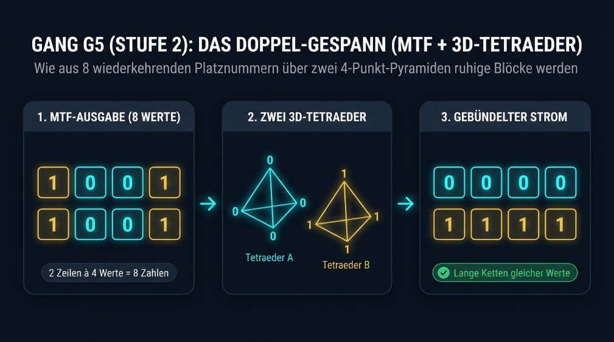

*Abbildung 2.30: Gang G5 (Stufe 2) – Das Doppel-Gespann (MTF + 3D-Tetraeder) – Links: Die MTF-Ausgabe liefert unsere kompakte Platznummern-Folge aus Stufe 1 über zwei wiederkehrende Zeilen hinweg (insgesamt 8 Zahlen: 1, 0, 0, 1 und 1, 0, 0, 1). Mitte & Rechts: Zwei 4-Punkt-Pyramiden (Tetraeder A für die vier Nullen, Tetraeder B für die vier Einsen) greifen alle 8 Werte räumlich ab und reihen sie zu geschlossenen Ketten identischer Zahlen auf (0, 0, 0, 0 | 1, 1, 1, 1).*

3. Der Rückweg (Entpacken): In zwei klaren Schritten zurück zum Original

Damit der Entpacker aus den verdichteten Blöcken wieder die exakte Originaldatei herstellt, läuft Gang G5 beim Öffnen des Archivs einfach exakt rückwärts – und kommt dabei völlig ohne gespeicherte Positionstabellen aus.

Im ersten Entpack-Schritt liegen dem Decoder die zwei sortierten Vierer-Blöcke „0, 0, 0, 0“ (für Tetraeder A) und „1, 1, 1, 1“ (für Tetraeder B) vor. Doch woher weiß er, in welcher Reihenfolge diese acht Zahlen ursprünglich standen? Hier greift dieselbe feste 3D-Koordinaten-Schablone im 2×2×2-Raumwürfel wie in Gang G3 (unsere zwei Vierer-Zeilen sind dabei lediglich die flach ausgerollte Speicher-Ansicht dieses Würfels): Beim Packen hatte Tetraeder A die vier Null-Positionen im Raum eingesammelt und Tetraeder B die vier Eins-Positionen. Weil der Decoder exakt dieselbe Schablone fest in seinem Bauplan trägt, verteilt er die vier Nullen von Tetraeder A und die vier Einsen von Tetraeder B einfach wieder auf ihre ursprünglichen Plätze zurück. Sofort stehen wieder die exakten MTF-Platznummern „1, 0, 0, 1“ und „1, 0, 0, 1“ bereit – ohne dass dafür auch nur ein einziges Zusatz-Bit gespeichert werden musste.

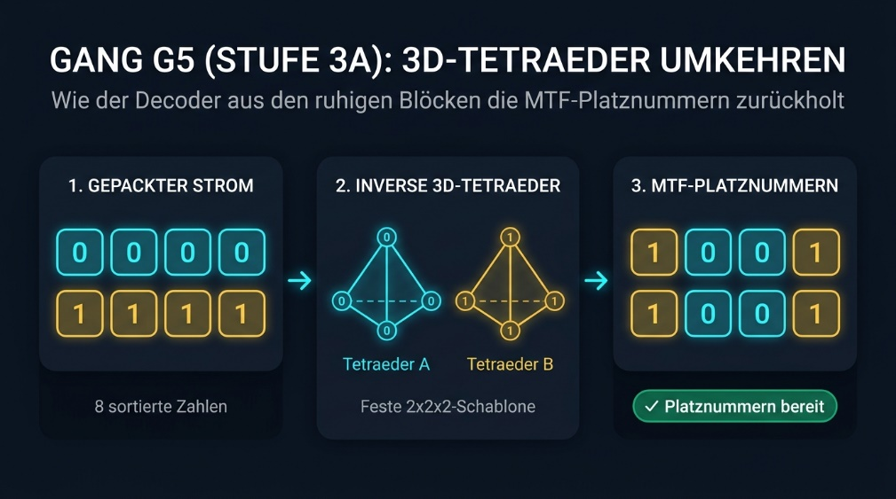

*Abbildung 2.31: Gang G5 (Stufe 3a) – Das 3D-Tetraeder umkehren – Anhand der fest einprogrammierten 3D-Koordinaten-Schablone im 2×2×2-Würfel verteilt der Decoder die vier Nullen von Tetraeder A und die vier Einsen von Tetraeder B wieder auf ihre ursprünglichen Raumplätze zurück und stellt so die exakten MTF-Platznummern-Folgen (1, 0, 0, 1 und 1, 0, 0, 1) bitgenau wieder her.*

4. Der Bücherstapel rückwärts (MTF-Umkehrung zum exakten Original)

Nachdem der Decoder die Platznummern-Folge „1, 0, 0, 1“ zurückgewonnen hat, legt er auf seinem eigenen Schreibtisch exakt denselben geordneten Startstapel an wie der Packer am Anfang (im echten Betrieb alle 256 Bytes von 0 bis 255, in unserem Beispiel A auf Platz 0, B auf Platz 1, C auf Platz 2 und D auf Platz 3). Jetzt arbeitet er die Zahlen einfach der Reihe nach ab:

- **Liest 1:** Er greift auf Platz 1 des Stapels, findet dort Buch B, gibt „B“ als erstes Original-Zeichen aus und legt Buch B anschließend nach ganz oben auf Platz 0.
- **Liest 0 und 0:** Zweimal hintereinander greift er ganz oben auf Platz 0, gibt zweimal „B“ aus – und Buch B bleibt oben liegen.
- **Liest 1:** Jetzt greift er wieder auf Platz 1, wo inzwischen Buch A wartet, gibt „A“ aus und legt Buch A nach oben (womit der Stapel wieder exakt in der Ausgangsordnung A, B, C, D liegt).
So entsteht aus „1, 0, 0, 1“ bitgenau die ursprüngliche Zeichenfolge „B, B, B, A“ (und über beide Zeilen hinweg wieder „B, B, B, A, B, B, B, A“). Weil Packer und Entpacker denselben Standard-Startstapel nutzen und jeden Griff identisch nach oben sortieren, braucht EULNO für dieses Kurzzeitgedächtnis kein einziges zusätzliches Speicher-Byte.

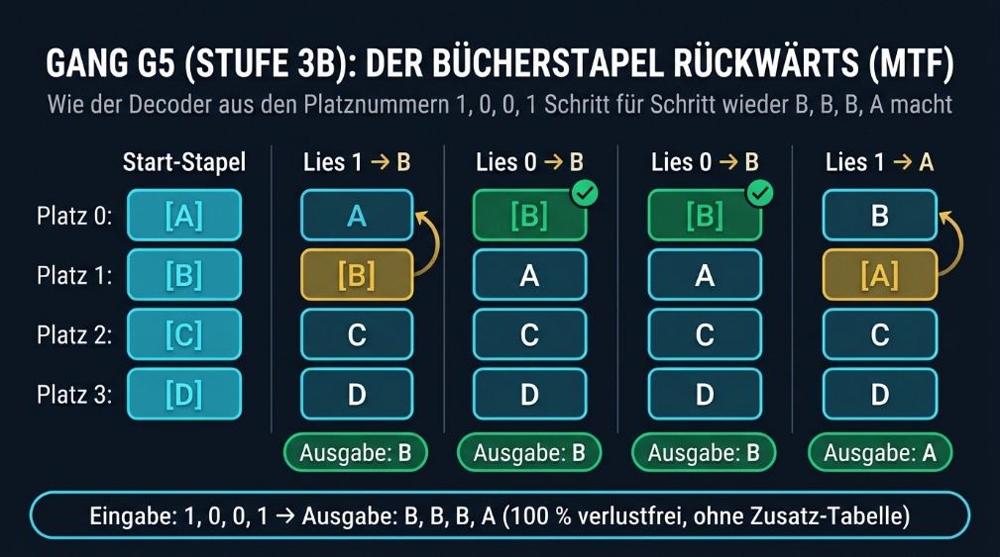

*Abbildung 2.32: Gang G5 (Stufe 3b) – Der Bücherstapel rückwärts (MTF-Umkehrung) – Ausgehend vom identischen Standard-Startstapel (A, B, C, D auf Platz 0 bis 3) liest der Decoder die Platznummern (1, 0, 0, 1) der Reihe nach aus, gibt das gefundene Zeichen aus und legt es nach oben. So entsteht 100 % verlustfrei und ohne Zusatz-Tabelle wieder die exakte Originalfolge „B, B, B, A“.*

- **Gang G6 – Das Wheel-8-Spiralrad (Der Takt-Sortierer für wiederkehrende 8er-Rhythmen)**
Viele moderne Dateien – etwa 64-Bit-Messwerte, wissenschaftliche Gleitkommazahlen, mehrkanalige Audiospuren oder strukturierte Programmpakete – schlagen in einem strengen 8-Byte-Takt. Würde ein Packprogramm diesen Strom einfach stur von links nach rechts lesen, lägen ganz unterschiedliche Byte-Rollen (wie Vorzeichen, grobe Größenordnung und feine Nachkommastellen) bunt gemischt direkt hintereinander. Gang G6 wickelt den Datenstrom deshalb wie auf ein Spiralrad mit genau acht Speichen (Speiche 0 bis Speiche 7) auf: Jedes Byte landet exakt auf der Speiche seiner Taktposition, sodass alle Werte derselben Rolle in glatten, ruhigen Spuren hintereinanderliegen – bevor der anschließende Feinschliff sie auf einen Bruchteil ihrer Größe verdichtet.

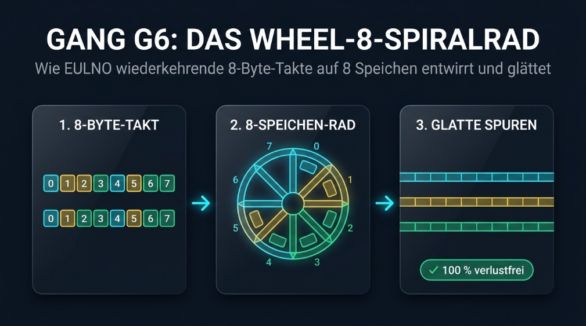

*Abbildung 2.33: Gang G6 – Das Wheel-8-Spiralrad im Überblick – EULNO führt wiederkehrende 8-Byte-Takte (1) auf ein virtuelles Spiralrad mit acht Speichen (2), sodass zusammengehörige Taktpositionen (Speiche 0 bis Speiche 7) in glatten, gleichförmigen Spuren gebündelt und anschließend 100 % verlustfrei verdichtet werden (3).*

1. Der 8-Byte-Herzschlag: Warum 64-Bit-Werte im linearen Speicher wie eine Zickzack-Reihe wirken

Moderne Computer, KI-Systeme und wissenschaftliche Messgeräte rechnen fast durchgehend mit sogenannten 64-Bit-Zahlen. Weil ein Byte aus 8 Bits besteht, belegt jede einzelne dieser Zahlen im Arbeitsspeicher exakt 8 Bytes am Stück (Position 0 bis Position 7). Dabei hat jedes dieser acht Bytes eine völlig andere Aufgabe: Ganz vorne stehen Vorzeichen und grobe Größenordnung (der „Kopf“ der Zahl), in der Mitte folgen die mittleren Stellen und ganz hinten sitzen die feinen Nachkomma-Details.

Schau dir in einem konkreten Beispiel drei leicht ansteigende Messwerte an (etwa drei Temperatur- oder Sensormessungen kurz hintereinander):

- **Messung 1:**   0 | 64 | 0 | 0 | 0 | 12 | 85 | 140
- **Messung 2:**   0 | 64 | 0 | 0 | 0 | 12 | 86 | 142
- **Messung 3:**   0 | 64 | 0 | 0 | 0 | 12 | 87 | 145
Betrachtet man diese drei Messungen untereinander, fällt sofort eine enorme Ruhe auf: Der vordere Teil (0, 64, 0, 0, 0, 12) bleibt bei allen drei Messungen komplett gleich, und nur ganz hinten bewegen sich die Werte sanft weiter (85 → 86 → 87 und 140 → 142 → 145). Doch im Arbeitsspeicher des Computers stehen diese Zahlen nicht schön untereinander, sondern als eine einzige lange, flache Zeile: „0, 64, 0, 0, 0, 12, 85, 140, 0, 64, 0, 0, 0, 12, 86, 142 …“. Verwandte Bytes liegen dadurch immer genau 8 Schritte auseinander, während dazwischen völlig unterschiedliche Byte-Rollen wie eine wilde Zickzack-Kurve auf- und abspringen.

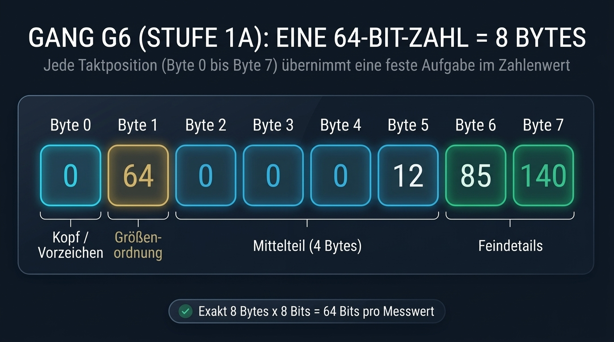

*Abbildung 2.34: Gang G6 (Stufe 1a) – Aufbau einer 64-Bit-Zahl aus 8 Bytes – Jede 64-Bit-Zahl belegt im Arbeitsspeicher exakt 8 Bytes (Byte 0 bis Byte 7), wobei jede Taktposition eine feste Aufgabe übernimmt: vom groben Kopf und der Größenordnung vorne über den Mittelteil bis zu den feinen Nachkomma-Details ganz hinten.*

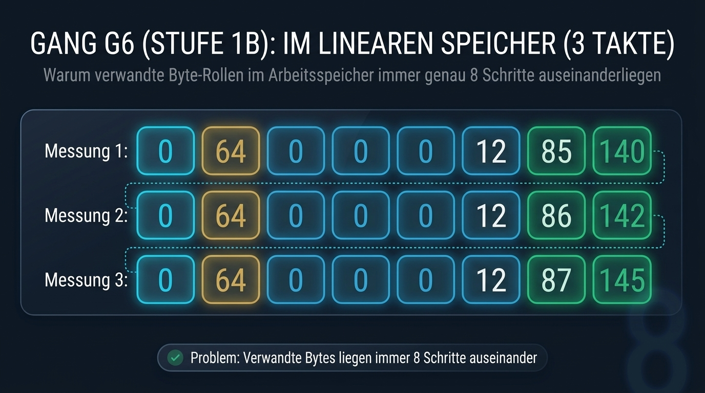

*Abbildung 2.35: Gang G6 (Stufe 1b) – Drei 64-Bit-Takte im linearen Speicher – Während die vorderen Bytes (0, 64, 0, 0, 0, 12) über alle drei Messungen hinweg identisch bleiben und sich nur die hinteren Stellen leicht verändern (85 → 86 → 87 sowie 140 → 142 → 145), liegen zusammengehörige Byte-Rollen im linearen Speicher immer genau 8 Schritte auseinander.*

Genau dieser strenge 8-Byte-Rhythmus – wie er in wissenschaftlichen Messreihen, KI-Modellen oder industriellen Sensor- und Steuerungsdaten (nach dem IEEE-754-Standard) millionenfach vorkommt – ist das ideale Spielfeld für EULNO: Statt über die ständigen 8er-Sprünge zu stolpern, nutzt Gang G6 diesen Takt gezielt aus und wickelt den gesamten Datenstrom auf sein achtteiliges Spiralrad auf.

2. Das 8-Speichen-Spiralrad in Aktion: Wie aus dem Zickzack acht glatte Spuren werden

Um diesen 8-Byte-Herzschlag zu bändigen, wickelt EULNO den Datenstrom in Stufe 2 auf ein virtuelles Spiralrad mit genau acht Speichen auf (Speiche 0 bis Speiche 7). Die Regel dahinter ist denkbar einfach: Jedes Byte wandert beim Einlesen genau auf die Speiche, die seiner Taktposition innerhalb der 64-Bit-Zahl entspricht.

Schauen wir uns das direkt an unseren drei Messwerten (M1, M2 und M3) an:

- **Alle ersten Bytes (Position 0) landen auf Speiche 0:**   0, 0, 0   (völlig konstant!)
- **Alle zweiten Bytes (Position 1) landen auf Speiche 1:**  64, 64, 64 (völlig konstant!)
- **Die mittleren Bytes (Position 2 bis 4) auf Speiche 2–4:** 0, 0, 0   (völlig konstant!)
- **Alle sechsten Bytes (Position 5) landen auf Speiche 5:** 12, 12, 12 (völlig konstant!)
- **Alle siebten Bytes (Position 6) landen auf Speiche 6:**  85, 86, 87 (sanfter Anstieg um +1)
- **Alle achten Bytes (Position 7) landen auf Speiche 7:**   140, 142, 145 (winzige Schritte +2, +3)
Statt einer wild springenden Zickzack-Reihe liegen nun alle acht Byte-Rollen fein säuberlich in eigenen Spuren hintereinander. Auf sechs der acht Speichen stehen nur noch identische Zahlenreihen, und selbst auf Speiche 6 und 7 folgen die Werte einer ruhigen, fast geraden Linie – ein gefundenes Fressen für den anschließenden Feinschliff und die finale Verdichtung.

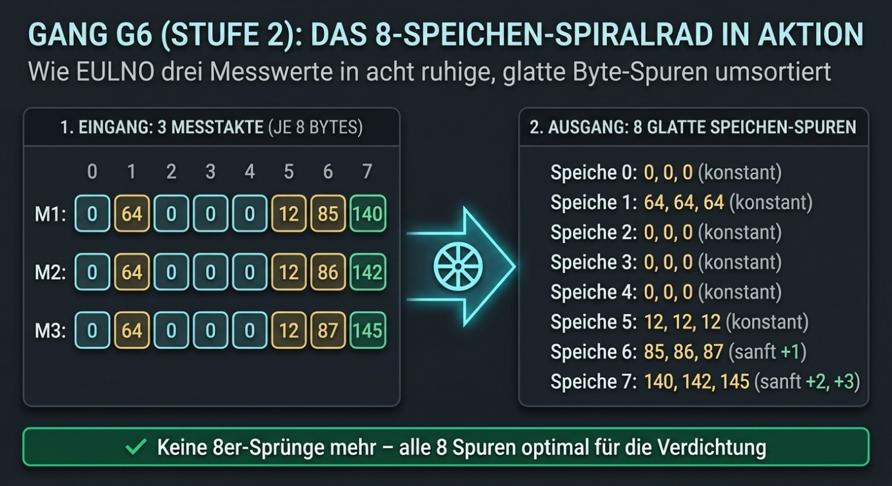

*Abbildung 2.36: Gang G6 (Stufe 2) – Das 8-Speichen-Spiralrad in Aktion – Links: Die drei aufeinanderfolgenden 64-Bit-Messwerte M1, M2 und M3 mit jeweils acht Byte-Positionen (0 bis 7). Rechts: Durch das Aufwickeln auf die acht Speichen des Spiralrads trennt EULNO die unterschiedlichen Byte-Rollen sauber voneinander, sodass acht ruhige, gleichförmige Einzelspuren (Speiche 0 bis Speiche 7) entstehen.*

3. Der Rückweg (Entpacken): Reißverschlussartig zurück zum exakten Original

Auch bei Gang G6 gilt das oberste EULNO-Gesetz: Keine einzige Positionstabelle muss mitgespeichert werden. Wenn der Entpacker das Archiv öffnet, entnimmt er dem kleinen Block-Kopf lediglich die Information „Gang G6“ sowie die Gesamtanzahl der Bytes im Block. Teilt der Decoder diese Gesamtlänge durch 8, kennt er sofort die exakte Länge jeder einzelnen Speichen-Spur (eventuelle Rest-Bytes am Blockende, die keinen vollen 8er-Takt mehr füllen, werden einfach unverändert angehängt).

Anschließend dreht der Decoder das Spiralrad wie einen Reißverschluss wieder rückwärts ab: Er nimmt jeweils das erste Byte von Speiche 0 bis Speiche 7 und setzt daraus wieder den kompletten ersten 64-Bit-Messwert (M1: 0, 64, 0, 0, 0, 12, 85, 140) zusammen. Danach folgt das jeweils zweite Byte aller acht Speichen für M2, das dritte für M3 und so weiter – bis jeder einzelne Messwert wieder bitgenau an seinem ursprünglichen Speicherplatz steht.

[PLATZHALTER BILD: Gang G6 (Stufe 3) – Der Rückweg: Das Spiralrad abwickeln]

*Abbildung 2.37: Gang G6 (Stufe 3) – Der Rückweg (Das Spiralrad abwickeln) – Anhand der im Block-Kopf hinterlegten Blocklänge kennt der Decoder die genaue Länge jeder Speichen-Spur und fädelt die Werte von Speiche 0 bis Speiche 7 reißverschlussartig wieder in ihre ursprünglichen 8-Byte-Takte (M1, M2, M3) zurück – 100 % verlustfrei und ohne Zusatz-Tabellen.*

### 2.3 Gesamtübersicht: Wie alle sieben Gänge (G0 bis G6) zusammenspielen – und das elp8-Archiv entsteht

Nachdem wir alle Spezialwerkzeuge einzeln kennengelernt haben, zeigt der Blick auf das Gesamtsystem, wie EULNO sie in Bruchteilen einer Sekunde dirigiert. Statt eine Datei stur durch einen einzigen Algorithmus zu pressen, zerlegt EULNO die Eingabedaten in handliche 1-MiB-Datenblöcke und führt jeden Block durch einen siebenstufigen Schaltkasten (Gang G0 bis Gang G6):

- **Gang G0 (Raw Bypass / 1:**1-Direktdurchlauf): Erkennt EULNO bereits beim ersten 16-KiB-Rauschtest („Entropy Noise Check“), dass ein Block aus völlig zufälligen oder bereits verschlüsselten Daten besteht, schaltet das Getriebe sofort in den Leerlauf und speichert den Block unverändert 1:1 – ohne Rechenzeit zu verschwenden oder die Datei aufzublähen.
- **Gang G1 (Turbo-ZigZag) & Gang G6 (Wheel-8-Spiralrad):** Diese beiden schnellen Vollblock-Gänge („Fast Full-Block Gears“) verarbeiten den gesamten 1-MiB-Block direkt am Stück – Gang G1 glättet sanfte Zahlenwellen mit Vorzeichenwechsel, während Gang G6 wiederkehrende 8-Byte-Takte (etwa 64-Bit-Zahlen) auf acht ruhige Speichen-Spuren sortiert.
- **Gang G2 (Hex-Nibble), Gang G3 (3D-Tetraeder), Gang G4 (Bit-Ebenen & Pascalsches Dreieck) & Gang G5 (MTF + 3D-Tetraeder):** Für komplexere Strukturen prüft EULNO anhand einer blitzschnellen 32-KiB-Stichprobe („32 KiB Split-Probe“ aus 16 KiB Anfang und 16 KiB Mitte), welcher der vier Spezialgänge die beste Vorordnung liefert – und lässt nur den Sieger dieser Vorrunde für den gesamten Block antreten.
Am Ende steht der unbestechliche MDL-Schiedsrichter („MDL Selector – Smallest Size Wins“, benannt nach dem mathematischen Prinzip der Minimum Description Length): Er vergleicht die tatsächlich erreichten Byte-Größen der Kandidaten und lässt ausschließlich den kleinsten, verlustfreien Block passieren.

Das elp8-Archiv: Ein offener Standard mit eingebautem Sicherheits-Anker

Alle Sieger-Blöcke werden schließlich gemeinsam in einer einzigen, kompakten Container-Datei zusammengeführt: dem elp8-Archiv (kurz für „EULNO Layered Protocol 8“, erkennbar an der Dateiendung .elp8). Um maximale Transparenz und langfristige Zukunftssicherheit zu gewährleisten, wurde das binäre Containerformat .elp8 unter der Kennung draft-heilos-eulno-elp8-00 offiziell als technischer Standard-Entwurf (Internet-Draft) eingereicht – inklusive der Beantragung des eigenen Internet-Medientyps application/elp8 bei der internationalen Vergabestelle IANA.

Was .elp8 von herkömmlichen Archivformaten wie ZIP unterscheidet, ist sein aktiver Sicherheits-Anker: Klassische Packer hängen eine Prüfsumme nur passiv ans Ende der Datei, um Fehler erst nach dem Entpacken zu bemerken. Das elp8-Format dreht dieses Prinzip um: Es berechnet bereits vor dem Packen einen kryptografischen Fingerabdruck (Anchor Hash per SHA-256 oder SHA-512) über die Originaldaten und nutzt genau diesen Fingerabdruck als mathematischen Startpunkt (Startspeiche S₀), um das 8-Speichen-Spiralrad auszurichten. Selbst kleinste Manipulationen oder Übertragungsfehler fallen dadurch sofort auf – und der Entpacker gibt erst dann eine einzige Datei frei, wenn der neu berechnete Fingerabdruck nach dem Entpacken bis aufs letzte Bit mit dem gespeicherten Anker übereinstimmt (atomare Quarantäne-Prüfung).

Der Aufbau des .elp8-Datei-Kopfes (Header) im Überblick

Jede .elp8-Datei beginnt mit einem streng genormten, selbsterklärenden Kopfbereich (je nach gewählter Sicherheitsstufe exakt 56, 88 oder 152 Bytes groß), sodass jedes Programm sofort alle wichtigen Eckdaten ablesen kann:

- **Erkennungszeichen („Magic Bytes“, 4 Bytes):** Die vier ASCII-Buchstaben „ELP8“ verraten jedem Betriebssystem sofort, dass es sich um ein echtes EULNO-Archiv handelt.
- **Version & Modus-Schalter („Version & Flags“, 2 Bytes):** Legt die Protokollversion (0x01) fest und schaltet per Bit-Schalter Funktionen wie das gegenläufige Spiralrad, den 7-Gänge-Blockmodus (G0–G6) oder eine optionale digitale Echtheits-Signatur frei.
- **Rad-Teilung & Hash-Verfahren (2 Bytes):** Bestimmt die Anzahl der Speichen (Standard: 8 Speichen) sowie das Prüfverfahren (SHA-256 oder SHA-512).
- **Originalgröße & Nutzdatenlänge (je 8 Bytes):** Zwei 64-Bit-Zahlen, die auf das Byte genau festhalten, wie groß die Datei vor und nach dem Packen ist – ein wirksamer Schutz gegen sogenannte „Dekompressions-Bomben“.
- **Kryptografischer Anchor-Hash (32 oder 64 Bytes):** Der unverfälschbare SHA-256- oder SHA-512-Fingerabdruck der Originaldatei zur Selbstprüfung und Rad-Ausrichtung.
- **Optionales Echtheits-Siegel („Origin Authentication Tag“, 64 Bytes):** Auf Wunsch ein zusätzliches kryptografisches Siegel (HMAC-SHA512 oder Ed25519), das nicht nur die Unversehrtheit der Daten, sondern auch den Absender garantiert.
Darunter folgen die einzelnen verdichteten Datenblöcke (Chunks), von denen jeder einen kompakten 9-Byte-Rahmen trägt: 1 Byte für den gewählten Gang (G0 bis G6), 4 Bytes für die Originalgröße des Blocks und 4 Bytes für seine geschrumpfte Größe.

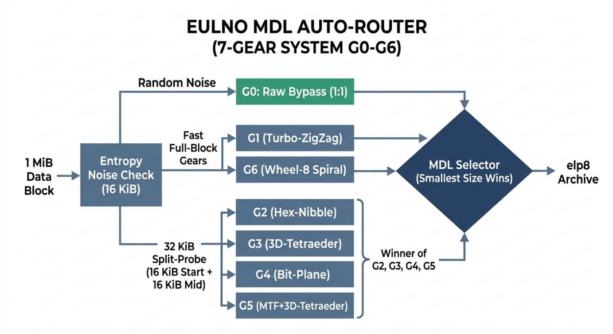

*Abbildung 2.38: Gesamtarchitektur des EULNO MDL Auto-Routers (7-Gänge-System G0–G6) und das elp8-Archiv – Jeder 1-MiB-Datenblock durchläuft zuerst einen schnellen Rausch-Check (16 KiB). Zufallsdaten gehen direkt über Gang G0 (Raw Bypass) in das Archiv, während strukturierte Daten parallel über die Vollblock-Gänge (G1, G6) und den Sieger der 32-KiB-Stichprobe (aus G2 bis G5) geprüft werden. Der MDL-Schiedsrichter („Smallest Size Wins“) wählt für jeden Block die kleinste Darstellung aus und schreibt sie zusammen mit dem Block-Kopf verlustfrei in das .elp8-Archiv.*

### 2.4 Einordnung und Würdigung: Von Euler und Noether zu vier Fachwelten unter einem Dach

Wer sich mit Datenkompression beschäftigt, bewegt sich zwangsläufig auf einem Fundament, das über Jahrhunderte hinweg von großen Denkern der Mathematik, Physik und Informationstheorie gelegt wurde. Diese tiefe Wertschätzung steckt bereits im Namen EULNO selbst: Er setzt sich aus den Anfangsbuchstaben zweier herausragender Persönlichkeiten der Wissenschaftsgeschichte zusammen – Leonhard Euler und Emmy Noether.

Euler erschloss die Sprache der universellen Berechnung, der Zahlentheorie und der Kombinatorik, während Noether die tiefen Symmetrien von Algebra und Physik offenlegte. Gerade Noethers Leitgedanke – dass hinter strukturellen Transformationen unveränderliche Invarianten stehen – diente als konzeptionelle Inspiration für dieses Programm: Diskrete Daten lassen sich durch bijektive Abbildungen geometrisch drehen, spiegeln und umsortieren, wobei ihr Informationsgehalt bis auf das letzte Bit erhalten bleibt. Gleichzeitig klingt der Name EULNO im Englischen wie „You’ll know“ („Du wirst es wissen“) – ein leiser Hinweis auf die Arbeitsweise der Engine, die nicht verlustbehaftet schätzt, sondern durch exakte Rechnung und kryptografische Prüfung bis aufs letzte Bit verlässliche Gewissheit schafft.

Als allererste Prüfdatei, mit der EULNO sein verlustfreies Packen und Entpacken unter Beweis stellen musste, diente eine kurze Widmung an genau diese beiden Vorbilder. Ihr Kerngedanke bildet auch den Leitfaden für dieses Buch: Wissenschaft und die Freude am Verstehen gehören allen Menschen – unabhängig von akademischen Titeln, Geschlecht oder Herkunft.

Weder EULNO noch das Containerformat .elp8 erheben daher den Anspruch, die Naturgesetze der Information neu zu erfinden. Jedes einzelne Werkzeug in diesem System ruht voller Respekt auf bewährten Erkenntnissen der Wissenschaft. Was EULNO jedoch aus der Begeisterung für die Zusammenhänge zwischen Mathematik, Physik und Informatik heraus geschaffen hat, ist die gezielte Verknüpfung von Methoden aus vier Fachgebieten innerhalb einer einheitlichen Container- und Kompressionsarchitektur:

- **Kryptografie trifft auf Geometrie (Das Hash-gekoppelte Spiegel-Rad in .elp8)**
Während herkömmliche Archivformate eine Prüfsumme lediglich als passiven Kontrollwert an das Dateiende anhängen, verwebt das .elp8-Protokoll die kryptografische Prüfsumme (SHA-256 oder SHA-512) direkt mit der geometrischen Ausrichtung der Daten. Der Fingerabdruck der Originaldatei bestimmt unmittelbar die Startspeiche (S₀) des gegenläufigen Modulo-8-Spiralrads („Inward-Mirror-Split“). Datenintegrität und geometrische Ordnung bilden dadurch eine untrennbare Einheit.

- **3D-Geometrie als tabellenfreier Datensortierer (Gang G3 – Tetra3D)**
Tetraeder-Strukturen sind aus der Physik, Strömungsmechanik und Computergrafik seit Langem bekannt. EULNO überträgt das Prinzip des regulären Tetraeders – als kleinstmögliches echtes dreidimensionales Raumgebilde (3-Simplex) – auf lineare Speicherblöcke. Durch die Zerlegung von 2×2×2-Datenwürfeln in komplementäre Vierer-Pyramiden werden räumlich benachbarte Werte durch eine fest definierte, bijektive Index-Abbildung streng deterministisch und ohne den Speicher-Overhead zusätzlicher Positionstabellen zusammengeführt.

- **Zeitliches Gedächtnis trifft auf räumliche Ordnung (Gang G5 – MTF + 3D-Tetraeder)**
Das Move-To-Front-Verfahren (MTF) wurde in der Informatik klassisch als eindimensionale Vorstufe für Textdaten eingesetzt. EULNO schaltet dieses Kurzzeitgedächtnis gezielt der dreidimensionalen Tetraeder-Projektion vor, sodass sowohl lokale Wiederholungsmuster als auch blockübergreifende Raumkorrelationen erfasst werden.

- **Informationstheorie als unbestechlicher Schiedsrichter (Der 7-Gänge-MDL-Router)**
Anstatt jede Datei durch einen einzigen starren Algorithmus zu pressen, behandelt EULNO jeden 1-MiB-Datenblock als eigenständige statistische und strukturelle Einheit. Über einen schnellen Vorab-Check lässt der MDL-Schiedsrichter („Minimum Description Length“) sieben grundverschiedene Ansätze (G0 bis G6) – von Zahlentheorie über Bit-Ebenen-Kombinatorik bis zur Rad-Geometrie – gegeneinander antreten und wählt objektiv die kompakteste verlustfreie Darstellung.

In diesem Sinne versteht sich EULNO nicht als Bruch mit der etablierten Wissenschaft, sondern als eine Brückenbau-Architektur: Sie zeigt, wie viel ungenutztes Potenzial entsteht, wenn man Werkzeuge aus Geometrie, Kombinatorik, Informationstheorie und Kryptografie wie Zahnräder eines fein abgestimmten Uhrwerks zusammenarbeiten lässt.

### 2.5 Technische Kurzfassung für die Fachwelt: Mathematische Notation und Strukturprinzipien

Für Leser aus Mathematik, Informatik und den Naturwissenschaften fasst dieser Abschnitt die sieben Transformations-Gänge von EULNO sowie die geometrische Phasenkopplung des .elp8-Containers in einheitlicher formaler Notation zusammen.

1. Bijektive Block-Transformationen und .elp8-Phasenanker

Die Eingabedatei X ∈ Σ* wird in disjunkte Datenblöcke (Chunks) B ∈ Σⁿ der Länge n Bytes zerlegt (Standard-Blockgröße n = 2²⁰ Bytes = 1 MiB; letzter Block entsprechend kürzer). Alle längenerhaltenden Vorverarbeitungsstufen g ∈ {G0, G1, G2, G3, G5, G6} definieren streng bijektive Block-Permutationen bzw. Byte-Bijektionen:

T_g : Σⁿ → Σⁿ   mit   T_g⁻¹(T_g(B)) = B

während Gang G4 als injektive kombinatorische Kodierung direkt in den Bitraum abbildet:

T_G4 : Σⁿ ↪ {0, 1}*

Sämtliche Stufen erhalten den Gesamtinformationsgehalt (die Quellenentropie) der Eingabe ohne Verlust, während sie die empirische Block-Entropie für den nachgelagerten Entropiekodierer gezielt absenken.

Vor der Blockzerlegung berechnet der Encoder über die gesamte Quelldatei X den kryptografischen Anchor-Hash H₀ = Hash(X) (SHA-256 oder SHA-512) und leitet daraus für ein Rad mit Modul M (Standard M = 8) die globale Startspeiche S₀ ab:

- **Globaler Phasenanker:** S₀ = uint64(H₀[0..7]) mod M
- **Lokaler Block-Phasenanker für Chunk i (i ≥ 0):** S_i = (S₀ + i) mod M
2. Formale Übersicht der sieben Gänge (G0 bis G6)

- **Gang G0 (Raw Bypass / Identitätsabbildung):**
T_G0(B) = B. Wird ausgelöst, wenn der vorgeschaltete 16-KiB-Entropietest hochgradiges Rauschen signalisiert, um eine Datenexpansion bei inkompressiblen Eingaben auszuschließen.

- **Gang G1 (Turbo-ZigZag / Vorzeichen-Bijektion):**
Bildet vorzeichenbehaftete Ganzzahlen z ∈ [−2^{w−1}, 2^{w−1} − 1] (im Zweierkomplement) der Wortbreite w ∈ {8, 16, 32, 64} Bit bijektiv auf vorzeichenlose Ganzzahlen {0, …, 2^w − 1} ab (für w = 8 identisch zur Ring-Bijektion ζ_ring aus Abschnitt 1.2):

ZigZag(z) = (z ≪ 1) ⊕ (z ≫_{arith} (w − 1))   (mit arithmetischer Rechtsverschiebung ≫_{arith}).

- **Gang G2 (Hex-Nibble-Zerlegung):**
Zerlegt jedes Byte b ∈ Σ in sein höherwertiges und niederwertiges Halb-Byte (Nibble): b_high = (b ≫ 4) ∧ 0x0F sowie b_low = b ∧ 0x0F, und gruppiert die 4-Bit-Teilströme nach lokaler Wertedichte neu.

- **Gang G3 (Tetra3D / 3-Simplex-Indexabbildung):**
Projiziert lineare Speicherbereiche als dreidimensionale Voxel-Gitter aus 2×2×2-Einheitswürfeln (8 Bytes). Jeder Einheitswürfel wird ohne Zusatz-Tabellen durch eine feste Index-Permutation in zwei komplementäre reguläre Tetraeder (3-Simplexe) der Koordinaten-Parität (x ⊕ y ⊕ z = 0) und (x ⊕ y ⊕ z = 1) zerlegt (mit unveränderter Identitäts-Durchreichung eines etwaigen Restblocks von n mod 8 Bytes am Blockende).

- **Gang G4 (Bit-Ebenen-Slicing & Kombinadik über das Pascalsche Dreieck):**
Transponiert 64-Byte-Blöcke in acht 64-Bit-Ebenen E_0, …, E_7 (mit optionaler Zeilen-Differenz E'_j = E_j ⊕ E_{j−1}). Eine 64-Bit-Zeile mit genau k gesetzten Einsen an den Bit-Positionen 0 ≤ c₁ < c₂ < … < c_k < 64 wird über das Binomial-Schema (Pascalsches Dreieck bis Reihe 64, mit der Standardkonvention C(a, b) = 0 für a < b) bijektiv auf ihren eindeutigen kombinatorischen Rang R abgebildet:

R = ∑_{i=1}^{k} C(c_i, i)   mit 0 ≤ R < C(64, k).

Gespeichert werden lediglich der Zähler k (7 Bit) und der Rang R (⌈log₂ C(64, k)⌉ Bit, z. B. 11 Bit für k = 2).

- **Gang G5 (Move-To-Front + 3D-Simplex-Kopplung):**
Führt zunächst auf einer dynamisch geführten Liste L = (l₀, …, l_{255}) eine MTF-Permutation durch (Ausgabe des aktuellen Listenindex idx(b) und Verschieben von b an Position 0) und unterzieht den erzeugten Indexstrom anschließend der 3D-Tetraeder-Projektion aus Gang G3.

- **Gang G6 (Wheel-8-Spiralrad & Inward-Mirror-Split):**
Verteilt den Byte-Strom zyklisch modulo M (M = 8) ab der Startspeiche S_i auf acht getrennte Speichen-Spuren (Spoke_s für s ∈ {0, …, 7}), wobei im Spiegel-Modus (Flag 0x02) die linke Blockhälfte [0 .. mid−1] vorwärts und die rechte Hälfte [mid .. n−1] mit mid = ⌊n / 2⌋ gegenläufig von außen nach innen auf die Speichen abgebildet wird.

3. Das MDL-Auswahlkriterium (Minimum Description Length)

Bezeichne C(T_g(B)) die nach der Entropie-Codierung (RFC 1951 / Deflate-Stufe bzw. direkter Bitstrom-Ausgabe bei G4) resultierende Bytelänge inklusive 9-Byte-Frame-Header. Der MDL-Router wählt für jeden Block B jene Transformation g* aus der geprüften Kandidatenmenge K ⊆ {G0, …, G6}, die die Beschreibungslänge minimiert:

g* = argmin_{g ∈ K} C(T_g(B))

Beim Entpacken rekonstruiert der Decoder alle Chunks anhand der gespeicherten Gang-IDs, prüft die exakte Gesamtlänge, berechnet in linearer Zeit 𝒪(|X|) den Prüf-Hash H₁ = Hash(Φ⁻¹(C)) und verifiziert in konstanter Zeit 𝒪(1) die Hash-Identität H₁ = H₀ über eine atomare Quarantäne-Datei, bevor die Ausgabedatei freigegeben wird.

---

## Kapitel 3: Der praktische User Guide – Bedienung und Praxisbeispiele

Wichtiger Hinweis vorab (Beta-Status):

Bei der vorliegenden Ausgabe von EULNO handelt es sich um eine aktive Beta-Version auf dem Weg zur offiziellen ersten Hauptversion (Version 1.0). Auch wenn EULNO jeden Vorgang durch kryptografische Fingerabdrücke (Anchor Hash) und eine atomare Quarantäne-Prüfung absichert, gilt für den Einsatz im Beta-Stadium grundsätzlich: Sichere deine Originaldaten immer vorab in einem eigenen Backup und lösche Quelldateien erst dann, wenn du das erstellte .elp8-Archiv erfolgreich geprüft oder vollständig zur Probe entpackt hast (ein teilweises Entpacken einzelner Bruchstücke ist wegen der durchgehenden Hash-Prüfung bewusst nicht möglich).

Nachdem wir in Kapitel 2 hinter die Kulissen geschaut und die sieben Gänge von EULNO kennengelernt haben, geht es nun in die tägliche Praxis. Die gute Nachricht vorweg: Im Alltag musst du dich weder um das Pascalsche Dreieck noch um Tetraeder-Koordinaten oder Speichen-Teilungen kümmern. Der eingebaute MDL-Schiedsrichter übernimmt die gesamte Analyse vollautomatisch – du übergibst einfach deine Datei, und EULNO wählt für jeden einzelnen Datenblock den optimalen Gang.

### 3.1 Die vier wichtigsten Grundbefehle und Optionen im Alltag

Für die tägliche Arbeit mit EULNO genügen vier selbsterklärende Hauptbefehle, die direkt über die Eingabeaufforderung (Terminal/Konsole) oder automatisiert in Skripten aufgerufen werden können:

1. Eine Datei oder einen ganzen Ordner verlustfrei packen (-c / --compress):

python eulno_pack.py -c messdaten.bin

Dabei liest EULNO die Quelldatei (oder einen kompletten Verzeichnisbaum) ein, berechnet vorab den kryptografischen Anchor-Hash (standardmäßig SHA-512), zerlegt die Daten in handliche Blöcke, wählt per MDL-Router automatisch den besten Gang (G0 bis G6) und schreibt das fertig gesicherte .elp8-Archiv. Mit -o ziel.elp8 lässt sich auf Wunsch ein eigener Ausgabepfad festlegen.

2. Ein Archiv wieder bitgenau entpacken (-x / --extract):

python eulno_pack.py -x messdaten.elp8

Der Entpacker liest den .elp8-Dateikopf aus, dreht alle gewählten Gänge (G0 bis G6) exakt rückwärts und prüft am Ende automatisch, ob der neu berechnete Fingerabdruck bis auf das letzte Bit mit dem gespeicherten Anchor-Hash übereinstimmt.

3. Die Unversehrtheit eines Archivs prüfen (-t / --test):

python eulno_pack.py -t messdaten.elp8

Ideal für Backups und Langzeitarchive: EULNO durchläuft den gesamten Datenstrom im Arbeitsspeicher und gleicht den kryptografischen Fingerabdruck ab, ohne eine Zieldatei auf die Festplatte schreiben zu müssen.

4. Blick in den .elp8-Dateikopf (-i / --info):

python eulno_pack.py -i messdaten.elp8

Zeigt übersichtlich an, welche Protokollversion verwendet wurde, wie groß die Originaldatei ist, auf welcher Startspeiche (S₀) das Spiralrad verankert ist und welche Kompressionsrate erreicht wurde.

Wichtige Zusatzschalter für Feinsteuerung & Sicherheit:

- **-m max / -m turbo:** Wählt das Arbeitsprofil – „max“ (Standard) nutzt alle sieben Gänge (G0–G6), während „turbo“ auf maximale Geschwindigkeit über die Basis-Gänge (G0, G1 und G6) setzt.
- **--hash sha512 / --hash sha256:** Legt das Prüfverfahren für den Anchor-Hash fest (Standard: SHA-512 mit 88-Byte-Header; optional SHA-256 für einen kompakten 56-Byte-Header).
- **--key-file <schlüsseldatei>:** Versieht das Archiv mit einem zusätzlichen 64-Byte-Echtheits-Siegel (Bit-3 Origin Authentication Tag).
- **-f (--force):** Erlaubt ausdrücklich das Überschreiben bereits vorhandener Zieldateien.
- **--delete-source:** Löscht die Quelldatei erst dann automatisch, nachdem das erstellte .elp8-Archiv vollständig und erfolgreich geprüft wurde (im Beta-Stadium bitte nur mit zusätzlichem Backup verwenden).
- **-v (--verbose) & --self-test:** Gibt den vollständigen hexadezimalen Fingerabdruck aus (-v) bzw. startet den eingebauten 5-stufigen Selbsttest der gesamten Engine (--self-test).

### 3.2 Praxisbeispiele: Welcher Datentyp profitiert wie?

Je nach Herkunft deiner Daten schaltet EULNO automatisch in unterschiedliche Gänge. Vier typische Beispiele aus dem Alltag zeigen, wie das Zusammenspiel in der Praxis wirkt:

- **Praxisbeispiel 1:** Industrie-Steuerungen (SPS) und Sensor-Messreihen
Ausgangslage: Eine Maschinensteuerung (etwa eine Siemens SIMATIC S7) protokolliert Temperatur-, Druck- oder Positionswerte als 64-Bit-Gleitkommazahlen (LREAL nach IEEE 754) im 8-Byte-Takt.

Was EULNO tut: Der Router erkennt sofort den strengen 8-Byte-Herzschlag und schaltet in Gang G6 (Wheel-8-Spiralrad). Während vordere Bytes mit unveränderter Größenordnung auf ruhigen Speichen gebündelt werden, fängt Gang G1 sanfte Messwellen ab. Das Archiv schrumpft deutlich – und bleibt dank SHA-256-Anker revisionssicher.

- **Praxisbeispiel 2:** KI-Modelle, Tensor-Gewichte und 3D-Simulationsdaten
Ausgangslage: Große Gewichtstabellen neuronaler Netze oder räumliche Gitterdaten (Voxel) weisen viele kleine Zahlenwerte und räumliche Nachbarschaften auf.

Was EULNO tut: Je nach Struktur greifen Gang G3 (3D-Tetraeder-Sortierer) und Gang G4 (Bit-Ebenen-Röntgenblick mit Pascalschem Dreieck). Ruhige obere Bit-Folien werden über Kombinatorik-Platznummern verdichtet, ohne dass auch nur eine Nachkommastelle verloren geht.

- **Praxisbeispiel 3:** Datenbank-Exporte, Tabellen und Quellcode
Ausgangslage: Strukturierte Textdateien, Logbücher oder Tabellen wiederholen dieselben Schlüsselwörter und Zahlenmuster in kurzen Abständen.

Was EULNO tut: Hier spielt Gang G5 (Move-To-Front + 3D-Tetraeder) sein Kurzzeitgedächtnis aus und verwandelt häufig genutzte Zeichenfolgen in lange Nullen-Ketten, während Gang G2 kompakte Halb-Byte-Muster bündelt.

- **Praxisbeispiel 4:** Bereits komprimierte Medien (ZIP, MP4, JPG) oder verschlüsselte Tresore
Ausgangslage: Du packst einen Ordner, in dem neben Messdaten auch bereits hochkomprimierte Videos oder verschlüsselte Dateien liegen.

Was EULNO tut: Beim 16-KiB-Rauschtest erkennt der Router sofort, dass sich die verschlüsselten Blöcke nicht weiter verdichten lassen. Er schaltet für genau diese Blöcke blitzschnell in Gang G0 (Raw Bypass), speichert sie 1:1 ohne Zeitverlust durch und versieht sie dennoch mit dem vollen kryptografischen Anchor-Hash des .elp8-Containers.

### 3.3 Eingebaute Sicherheits-Schutzschilde im täglichen Betrieb

Damit im Alltag weder durch Bedienungsfehler noch durch beschädigte Dateien aus dem Internet ein Schaden entsteht, folgt EULNO den strengen Sicherheitsregeln der .elp8-Spezifikation:

- **Atomare Quarantäne beim Entpacken:** EULNO schreibt entpackte Daten zunächst immer in eine geschützte, unsichtbare Zwischendatei. Erst wenn alle Blöcke vollständig wiederhergestellt sind und der kryptografische Anchor-Hash zu 100 Prozent übereinstimmt, wird die Datei am Zielort freigegeben. Bei einem Übertragungsfehler erhältst du niemals eine heimlich beschädigte Datei.
- **Schutz vor versehentlichem Überschreiben:** EULNO lehnt es automatisch ab, die Quelldatei direkt zu überschreiben, und überschreibt bestehende Zieldateien nur dann, wenn du dies ausdrücklich freigibst.
- **Schutz vor „Dekompressions-Bomben“:** Weil im .elp8-Kopfbereich sowohl die exakte Originalgröße als auch die zulässige Blockgröße fest verankert sind, bricht der Entpacker sofort ab, falls ein manipuliertes Archiv versucht, den Arbeitsspeicher unkontrolliert zu fluten.

---

## Kapitel 4: Einordnung, Stärkenprofil & physikalische Grenzen

Nach dem Blick in die praktische Bedienung stellt sich für jeden Anwender und Fachleser die Frage: Wo liegt der besondere Mehrwert von EULNO gegenüber etablierten Packprogrammen – und wo verlaufen die unverrückbaren Grenzen der Datenkompression? Da sich EULNO aktuell im Beta-Stadium (v0.9.5-beta) befindet, verzichtet dieses Handbuch bewusst auf vorläufige Hardware-Geschwindigkeitstabellen und konzentriert sich stattdessen auf das strukturelle Stärkenprofil sowie die mathematischen Naturgesetze hinter jeder verlustfreien Verdichtung.

### 4.1 Einordnung gegenüber klassischen Packprogrammen (ZIP, GZIP, Zstd)

Klassische Allzweck-Packer wie ZIP, GZIP oder Zstandard (Zstd) sind hervorragende Werkzeuge für alltägliche Bürodateien und Texte. Sie arbeiten überwiegend nach dem sogenannten Wörterbuch-Prinzip (LZ77): Sie suchen im Datenstrom nach wiederkehrenden Zeichenketten und ersetzen Wiederholungen durch einen kurzen Verweis auf eine frühere Stelle.

Bei strukturierten Zahlenräumen, 64-Bit-Sensorprotokollen, mehrdimensionalen Matrizen oder KI-Gewichten stößt eine reine Text-Wörterbuchsuche jedoch oft an Grenzen, weil identische Zahlen selten exakt als lange Byte-Kette wiederkehren, sondern sich sanft verändern oder in festen Taktabständen (z. B. alle 8 Bytes) liegen. Genau hier ergänzt EULNO die klassische Welt:

- **Struktur-Vorordnung vor der Entropie-Codierung:** EULNO ersetzt die bewährte Entropie-Codierung nicht, sondern schaltet ihr mit den Gängen G1 bis G6 eine geometrische, kombinatorische und ring-arithmetische Vorstufe vor, die verborgene Ordnungen überhaupt erst sichtbar macht.
- **Aktiver Integritäts-Anker statt passiver Prüfsumme:** Während klassische Formate eine Prüfsumme lediglich ans Dateiende anhängen, koppelt das .elp8-Format den kryptografischen Fingerabdruck (SHA-256 / SHA-512) direkt an die Rad-Geometrie und erzwingt beim Entpacken eine atomare Quarantäne-Prüfung.
- **Bewusste Spezialisierung statt Einheitslösung:** Auf reinen Fließtexten arbeiten hochoptimierte Wörterbuch-Packer oft bereits nahe am Optimum; seine besondere Stärke spielt EULNO überall dort aus, wo Zahlenfolgen, 8-Byte-Takte, dünn besetzte Bit-Ebenen oder dreidimensionale Nachbarschaften dominieren.

### 4.2 Physikalische und mathematische Grenzen (Das Shannon-Limit)

In der Geschichte der Informatik tauchten immer wieder Versprechen auf, man könne jede beliebige Datei beliebig oft hintereinander komprimieren. Die Mathematik zeigt jedoch mit unbestechlicher Klarheit, dass dies unmöglich ist – und EULNO respektiert diese Grenzen ohne Einschränkung:

- **Das Schubfachprinzip (Pigeonhole Principle)**
Wenn man 100 Tauben auf 99 Taubenschläge verteilt, müssen mindestens zwei Tauben im selben Schlag sitzen. Übertragen auf die Informatik bedeutet das: Kein verlustfreier Algorithmus der Welt kann *alle* möglichen Dateien verkleinern, ohne dass zwei verschiedene Originaldateien dasselbe Archiv ergäben – was ein eindeutiges Entpacken unmöglich machen würde. Wird eine Datei kleiner, muss eine andere zwangsläufig gleich groß bleiben oder minimal wachsen.

- **Die Shannon-Entropie (Der wahre Informationsgehalt)**
Der Begründer der Informationstheorie, Claude Shannon, bewies 1948, dass jede Datenquelle eine feste Untergrenze für die verlustfreie Komprimierung besitzt: die sogenannte Entropie. Besteht eine Datei bereits aus echtem Zufallsrauschen oder ist sie sauber verschlüsselt (wie ein AES-Tresor oder ein fertiges MP4-Video), enthält jedes Byte die maximal möglichen 8 Bit an unvorhersehbarer Information. Eine weitere Verkleinerung ist dann physikalisch und mathematisch ausgeschlossen.

- **EULNOs ehrliche Antwort darauf (Gang G0 – Raw Bypass)**
Anstatt gegen diese Naturgesetze anzukämpfen und Zufallsdaten durch nutzlose Rechenarbeit aufzublähen, erkennt EULNO unkomprimierbare Blöcke bereits im 16-KiB-Rauschtest und reicht sie über Gang G0 (Raw Bypass) unverändert 1:1 durch. So bleibt das Archiv im schlechtesten Fall praktisch genauso groß wie das Original – profitiert aber dennoch vom vollen kryptografischen Schutz des .elp8-Containers.

---

## ANHANG B: GLOSSAR & VERZEICHNIS DER TECHNISCHEN NORMEN

- **Anchor-Hash (Sicherheits-Anker):**
Ein kryptografischer Fingerabdruck (SHA-256 oder SHA-512), den EULNO noch vor dem Packen über die gesamte Originaldatei berechnet und im Kopf des .elp8-Archivs ablegt. Er dient doppelt: Zum einen legt er die Startspeiche (S₀) des Wheel-8-Spiralrads fest, zum anderen prüft der Entpacker damit bis auf das letzte Bit die Unversehrtheit der wiederhergestellten Datei.

- **ARM / x86 (CPU-Architekturen):**
Die beiden wichtigsten Bauarten moderner Computerprozessoren (x86 steckt in den meisten Windows-PCs und Laptops, ARM in Smartphones, Tablets und modernen Mac-Computern). Weil EULNO streng ohne Fließkommazahlen arbeitet, liefert das Programm auf beiden Prozessorwelten bitgenau identische Ergebnisse.

- **ASCII (American Standard Code for Information Interchange):**
Ein klassischer Zeichensatz-Standard, der Buchstaben, Ziffern und Steuerzeichen festen Zahlenwerten zuordnet. Im .elp8-Archiv sorgen die vier ASCII-Zeichen „ELP8“ ganz am Dateianfang als Erkennungszeichen („Magic Bytes“) dafür, dass das Archivformat sofort erkannt wird.

- **Atomare Quarantäne:**
Ein Sicherheitsmechanismus beim Entpacken: EULNO schreibt wiederhergestellte Daten zunächst in eine unsichtbare, abgeschirmte Zwischendatei. Erst wenn alle Blöcke vollständig entpackt sind und der Prüf-Hash exakt mit dem gespeicherten Anchor-Hash übereinstimmt, wird die Datei in einem einzigen Schritt am Zielort freigegeben.

- **Big-Endian (Network Byte Order):**
Eine festgelegte Speicherreihenfolge für mehrstellige Zahlen im Computer, bei der das höchstwertige Byte (der „grobe Zahlenkopf“) immer ganz vorne an erster Stelle steht. Alle Zahlenfelder im .elp8-Dateikopf folgen dieser einheitlichen Norm.

- **Bijektion / Bijektive Abbildung:**
Ein mathematischer Begriff für eine streng umkehrbare Eins-zu-eins-Zuordnung (wie ein perfektes Puzzle). Jedem Element der Originaldatei entspricht genau ein Element im verarbeiteten Block – und umgekehrt. Dadurch ist mathematisch garantiert, dass beim Packen und Entpacken niemals Information verloren geht.

- **Bit & Byte:**
Das Bit (kurz für „Binary Digit“) ist die kleinste digitale Informationseinheit und kennt nur zwei Zustände: 0 (AUS) oder 1 (AN). Acht Bits zusammen ergeben ein Byte, das genau 256 verschiedene Zustände (die Zahlen von 0 bis 255) darstellen kann.

- **Chunk (Datenblock):**
Ein handlicher Teilabschnitt einer großen Datei. EULNO zerlegt Eingabedateien standardmäßig in 1-MiB-Chunks (1.048.576 Bytes), damit der MDL-Router für jeden Abschnitt einzeln den besten Kompressions-Gang auswählen kann.

- **CLI (Command Line Interface):**
Die Kommandozeile (Eingabeaufforderung oder Terminal), über die Programme wie EULNO schnell, direkt und ohne grafische Umwege per Textbefehl gesteuert oder in automatische Abläufe (Skripte) eingebunden werden können.

- **CPU (Central Processing Unit):**
Der Hauptprozessor eines Computers, der alle Rechenbefehle ausführt.

- **Dekompressions-Bombe (Decompression Bomb):**
Ein manipuliertes, winziges Archiv, das beim Entpacken absichtlich gigantische Datenmengen erzeugt, um den Arbeitsspeicher eines Computers zum Absturz zu bringen. EULNO verhindert dies, indem die exakte Originalgröße und maximale Blockgröße im .elp8-Kopf fest begrenzt sind.

- **Ed25519 / HMAC-SHA512 (Echtheits-Siegel):**
Moderne kryptografische Signatur- und Prüfverfahren. Im .elp8-Format können sie optional als 64 Byte langes „Origin Authentication Tag“ im Datei-Kopf eingebettet werden, um nicht nur die Unversehrtheit der Daten, sondern auch die Identität des Absenders abzusichern.

- **.elp8 / .elp3d (EULNO Layered Protocol 8):**
Das offene binäre Containerformat von EULNO für verlustfrei komprimierte Archive (.elp8) sowie dreidimensionale Datensätze (.elp3d), spezifiziert im IETF Internet-Draft draft-heilos-eulno-elp8-00.

- **Flags (Status-Schalter):**
Einzelne Bits innerhalb eines Steuer-Bytes im Datei-Kopf, die wie kleine Kippschalter bestimmte Funktionen ein- oder ausschalten (z. B. ob das gegenläufige Spiralrad oder eine digitale Echtheits-Signatur aktiv ist).

- **GB (Gigabyte):**
Speichereinheit für große Datenmengen: 1 Gigabyte entspricht im dezimalen Maßsystem 1.000 Megabyte (1 Milliarde Bytes).

- **Geodäte (Kürzeste Ring-Distanz):**
Der kürzeste Weg zwischen zwei Punkten auf einer gekrümmten Fläche oder einem Kreis. Auf der 256-Stunden-Uhr von EULNO wählt der Algorithmus zwischen zwei Byte-Werten immer den kürzeren Schritt vorwärts oder rückwärts (maximal −128 bis +127), um künstliche Sprünge am Überlaufpunkt (255 ↔ 0) zu vermeiden.

- **Header (Datei- bzw. Block-Kopf):**
Der streng genormte Vorspann am Anfang einer Datei oder eines Datenblocks. Er enthält keine Nutzdaten, sondern den „Steckbrief“ für den Entpacker (z. B. Dateityp, Originalgröße, gewählter Gang und Prüfsumme).

- **IANA (Internet Assigned Numbers Authority):**
Die internationale Koordinierungsstelle, die weltweit eindeutige technische Kennungen im Internet verwaltet – darunter auch offizielle Dateityp-Bezeichnungen (Media Types wie application/elp8).

- **IEEE 754 (Standard for Floating-Point Arithmetic):**
Internationale Industrienorm des Institute of Electrical and Electronics Engineers (erstveröffentlicht 1985, aktuell IEEE 754-2019). Sie legt fest, wie Prozessoren Gleitkommazahlen (Kommazahlen) binär darstellen und runden. EULNO schließt IEEE-754-Operationen im gesamten Rechenwerk strikt aus, um Rundungsfehler und Hardware-Abweichungen zwischen verschiedenen CPU-Architekturen (z. B. x86 und ARM) mathematisch unmöglich zu machen.

- **IETF / RFC Internet-Draft:**
Die Internet Engineering Task Force (IETF) ist das internationale Gremium zur Entwicklung offener Internet- und Protokollstandards (veröffentlicht als „Request for Comments“, kurz RFC). Ein „Internet-Draft“ (wie draft-heilos-eulno-elp8-00) ist der offizielle technische Standard-Entwurf auf diesem Weg.

- **KB vs. KiB (Kilobyte vs. Kibibyte):**
In der Computerwelt gibt es zwei Zählweisen: 1 Kilobyte (KB) steht im dezimalen System für glatte 1.000 Bytes. Weil Computer jedoch in Zweierpotenzen rechnen, steht 1 Kibibyte (KiB) exakt für 2¹⁰ = 1.024 Bytes (16 KiB sind also 16.384 Bytes, 32 KiB sind 32.768 Bytes).

- **Kombinadik (Combinadics):**
Ein mathematisches Nummerierungsverfahren aus der Kombinatorik. Mithilfe des Pascalschen Dreiecks ordnet es jeder möglichen Stellung von k Einsen in einer Bit-Zeile eine eindeutige Platznummer (Rang) zu – und rechnet sie beim Entpacken ebenso eindeutig wieder zurück.

- **Latent Space (Latentraum) & Tensor:**
Begriffe aus der künstlichen Intelligenz: Ein Tensor ist ein mehrdimensionales Zahlengitter (die Erweiterung einer Tabelle in drei oder mehr Dimensionen). Als Latent Space bezeichnet man den inneren mathematischen Raum eines KI-Modells, in dem verwandte Merkmale räumlich nah beieinander liegen.

- **LREAL (64-Bit-Gleitkommazahl in der Industrie-Automatisierung):**
Datentyp in Speicherprogrammierbaren Steuerungen (SPS, z. B. Siemens SIMATIC S7), der hochgenaue Sensor- und Messwerte nach der Norm IEEE 754 in exakt 8 Bytes (64 Bits) hintereinander im Speicher ablegt.

- **Magic Bytes (Erkennungs-Bytes):**
Eine festgelegte Folge von Bytes ganz am Anfang einer Datei (bei EULNO die vier Zeichen „ELP8“), an der Betriebssysteme und Programme das Dateiformat zweifelsfrei erkennen – unabhängig von der Dateiendung.

- **MB vs. MiB (Megabyte vs. Mebibyte):**
Analog zu KB und KiB steht 1 Megabyte (MB) für 1.000.000 Bytes, während 1 Mebibyte (MiB) exakt 2²⁰ = 1.048.576 Bytes (1.024 Kibibyte) umfasst. Die Standard-Blockgröße von EULNO beträgt genau 1 MiB.

- **MDL (Minimum Description Length / Minimale Beschreibungslänge):**
Ein Grundprinzip der Informationstheorie: Von mehreren möglichen Beschreibungen derselben Daten ist diejenige am besten, die insgesamt am wenigsten Speicherplatz benötigt. In EULNO wählt der MDL-Router nach diesem Prinzip für jeden Block den Gang mit der kleinsten Byte-Anzahl.

- **Modulo (Restklassen-Rechnung, z. B. mod 256 oder mod 8):**
Das Rechnen auf einem geschlossenen Zifferblatt (wie bei einer Uhr). Bei „mod 256“ springt die Zahl nach 255 wieder auf 0 zurück; bei „mod 8“ (dem Wheel-8-Spiralrad) wiederholen sich die Speichen-Nummern 0 bis 7 immer wieder im Kreis.

- **MTF (Move-To-Front / Nach vorne holen):**
Ein Verfahren, das wie ein Bücherstapel funktioniert: Jedes gelesene Zeichen wird sofort nach ganz oben auf Platz 0 gelegt. Wiederholen sich bestimmte Zeichen häufig, entsteht eine lange Folge aus Nullen und kleinen Platznummern.

- **Nibble (Halb-Byte):**
Eine Gruppe aus 4 Bits – also genau ein halbes Byte. Ein Nibble kann 16 verschiedene Werte annehmen (0 bis 15 bzw. hexadezimal 0 bis F). Jedes Byte besteht aus einem oberen (High-Nibble) und einem unteren Halb-Byte (Low-Nibble).

- **Pascalsches Dreieck:**
Ein klassisches Zahlendreieck aus der Kombinatorik (benannt nach Blaise Pascal), bei dem jede Zahl die Summe der beiden Zahlen direkt schräg darüber ist. EULNO nutzt es in Gang G4 als 17 Kilobyte kleine Nachschlagetabelle, um 64-Bit-Zeilen verlustfrei in kompakte Platznummern umzurechnen.

- **Raw-Bypass (Direktdurchlauf, Gang G0):**
Das unveränderte 1:1-Durchreichen eines Datenblocks ohne Kompressionsversuch. Wird aktiviert, wenn Daten aus reinem Zufallsrauschen bestehen oder bereits optimal gepackt sind, um eine künstliche Vergrößerung der Datei zu verhindern.

- **SHA-256 & SHA-512 (Secure Hash Algorithm):**
Weltweit anerkannte kryptografische Prüfverfahren, die aus einer beliebig großen Datei einen eindeutigen digitalen Fingerabdruck fester Länge (256 Bits = 32 Bytes bzw. 512 Bits = 64 Bytes) berechnen. Schon die Änderung eines einzigen Bits in der Datei verändert den Fingerabdruck komplett.

- **Shannon-Entropie:**
Ein nach dem Mathematiker Claude Shannon benanntes Maß für den Informationsgehalt und die Unordnung (Zufälligkeit) einer Datenfolge. Je höher die Entropie (maximal 8 Bit pro Byte bei reinem Rauschen), desto weniger lässt sich eine Datei verlustfrei verkleinern.

- **Split-Probe (32-KiB-Testfahrt):**
Ein Schnelltest-Verfahren von EULNO, bei dem 16 KiB vom Anfang und 16 KiB aus der Mitte eines Datenblocks kombiniert werden, um die Spezialgänge (G2 bis G5) realistisch zu testen, ohne von stiller Einleitung (z. B. bei Musikdateien) getäuscht zu werden.

- **Stride (Sprungweite):**
Der feste Abstand in Bytes, mit dem Gang G1 durch den linearen Arbeitsspeicher springt (z. B. s = 1 für den direkten Nachbarn, s = 32 für eine Tabellenzeile oder s = 512 für eine ganze 3D-Schicht).

- **Tetraeder (3-Simplex):**
Eine Pyramide mit dreieckiger Grundfläche und insgesamt vier Eckpunkten. Es ist das geometrisch kleinste echte dreidimensionale Raumgebilde. EULNO zerlegt in Gang G3 kleine 2×2×2-Datenwürfel in zwei solche Vierer-Pyramiden.

- **Voxel (Volume Pixel):**
Ein dreidimensionaler Datenpunkt in einem Raumgitter – das räumliche Gegenstück zu einem zweidimensionalen Bildpunkt (Pixel).

- **XOR (Exklusiv-ODER, Symbol ⊕):**
Eine grundlegende logische Bit-Operation: Vergleicht man zwei Bits miteinander, ist das Ergebnis 1, wenn beide Bits unterschiedlich sind (0 und 1), und 0, wenn beide gleich sind (0 und 0 oder 1 und 1). Der besondere Vorteil: Wendet man XOR zweimal mit demselben Wert an, erhält man wieder exakt das Original zurück.

- **ZigZag-Codierung:**
Ein bijektives Umnummerierungsverfahren, das positive und negative Zahlen abwechselnd auf reine positive Zahlen abbildet (0 → 0, −1 → 1, +1 → 2, −2 → 3, +2 → 4 …), sodass kleine Abweichungen um die Null herum immer kleine Byte-Werte ergeben.
